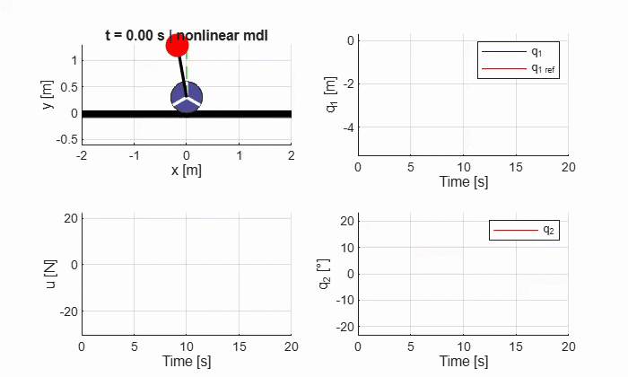
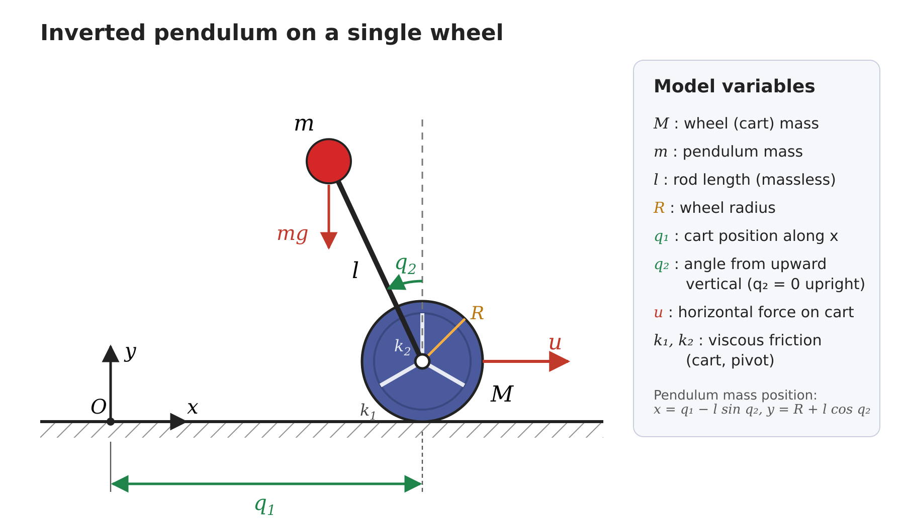

# Pendulum-Cart Control: from Lagrangian modeling to sliding mode control

  

Modeling, analysis and control of a single-wheel inverted pendulum (Segway type) in MATLAB/Simulink. Five controllers are designed on the linear model and compared on the validated nonlinear model.



## The problem



A wheel of mass *M* carries a pendulum of mass *m* on a massless rod of length *l*. A horizontal force *u* drives the wheel. The goal is to keep the pendulum upright (q₂ = 0) while moving the wheel to a commanded position q₁.

| Parameter | Value |
|---|---|
| Wheel mass M | 1.5 kg |
| Pendulum mass m | 0.5 kg |
| Rod length l | 1 m |
| Viscous friction k₁, k₂ | 0.01 |

<br clear="right">

## What's inside

| Step | Method |
|---|---|
| Modeling | Lagrange equations with Rayleigh dissipation |
| Linearization | Small-angle model around the upright position (4 states) |
| Model validation | Fall test, linear vs nonlinear, two independent nonlinear implementations |
| Analysis | Poles, zeros, controllability, observability, modal form |
| Control | PID, pole placement, LQR, Luenberger observer, LQR with integral action, sliding mode control |
| Comparison | All controllers on one scenario: nonlinear model, 10° initial tilt, wheel step to −5 m |

## Key results

- **Open-loop unstable:** one pole at s = +3.60; the pendulum falls in about one second.
- **Zero at s = 0 from u to q₂:** no proportional controller can stabilize the pendulum, the reference gain for the angle is infinite, and integral action on the angle is impossible (the augmented system loses controllability). Integral action is therefore placed on the wheel position.
- **Right-half-plane zero at s = +3.12 from u to q₁:** every move starts in the wrong direction, by up to 9% of the move for the fastest controller. It also rules out a PID on the wheel position alone.
- **Observability:** the full state can be reconstructed from q₁ (rank 4) but not from q₂ (rank 3), so the observer measures the wheel position.
- **Validated simulation model:** two independent nonlinear implementations agree within 0.019°, and the linear model stays within 0.66° of them at 17°.

### Controller comparison (nonlinear model, wheel step to −5 m)

| Controller | Settling time (2%) | Wrong-way start | Max angle | Max force |
|---|---|---|---|---|
| Pole placement | 2.75 s | 9.2% | 34.8° | 61.9 N |
| LQR | 4.77 s | 3.6% | 14.4° | 15.8 N |
| Pole placement + observer | 4.36 s | 5.6% | 21.4° | 32.2 N |
| **LQR + integral (q₁) + observer** | **5.44 s** | **0%** | **6.1°** | **2.5 N** |
| SMC (p = 3, k₀ = 20) | 2.86 s | 5.0% | 23.4° | 22.7 N |
| SMC (p = 5, k₀ = 50) | 2.48 s | 5.7% | 20.7° | 50.0 N |

For a real vehicle, where motor force is limited and only the wheel position is measured, **LQR with integral action and an observer is the best trade-off**: one sensor, 25 times less force than pole placement, the smallest tilt and no steady-state error, at the cost of a slower move. If all states are measured and speed matters more, SMC with p = 3 is the best fast design.

The full derivation, figures and discussion are in **[docs/report.md](docs/report.md)** ([PDF](docs/report.pdf)).

## How to run

Requirements: MATLAB R2024b or later, Simulink, Control System Toolbox.

```matlab
openProject("pendulum-cart-control.prj")   % sets up the paths
open main.mlx                              % then Run All
```

## Repository structure

```
├── main.mlx        live script: model, analysis, controllers, comparison
├── src/            parameters, state-space model, nonlinear dynamics, metrics, animation
├── models/         Simulink models (shared plant models + one model per controller)
├── docs/           full report (Markdown and PDF) and figures
└── media/          animation
```

## What I learned

- **Zeros shape what a controller can do.** The zero at the origin and the right-half-plane zero explain most of the limitations met in this project, from P control to integral action.
- **Validate the simulation model before trusting a controller.** Comparing two independent implementations revealed modeling errors that a single model would have hidden.
- **Speed costs force and wrong-way motion.** Faster designs need much larger forces and amplify the effect of the right-half-plane zero.
- **A real controller works with what is measured.** The observer and the choice of the measured output follow directly from the observability analysis.

## License

[MIT](LICENSE)
