<a id="TMP_8ffc"></a>
<a id="TMP_741c"></a>

# Pendulum cart control

This report models and controls a single-wheel inverted pendulum (Segway type): a wheel of mass M carries a pendulum of mass m on a massless rod of length l, and a horizontal force u drives the wheel. The goal is to keep the pendulum upright (q₂ = 0) while moving the wheel to a commanded position q₁. The report derives the nonlinear model, analyses the linearized system, validates the simulation models, then designs and compares five controllers: PID, pole placement, LQR, observer-based LQR with integral action, and sliding mode control. Unless stated otherwise, every controller is designed on the linear model and tested on the nonlinear one.


<!-- Begin Toc -->

## Table of Contents
&#8195;&#8195;[1. Model of the system](#TMP_6f79)
 
&#8195;&#8195;[2. Model linearization](#TMP_2298)
 
&#8195;&#8195;[3. Simulink Model of the system](#TMP_384f)
 
&#8195;&#8195;[4. System analysis](#TMP_5f4a)
 
&#8195;&#8195;&#8195;[Stability](#TMP_13e9)
 
&#8195;&#8195;&#8195;[Controllability and observability](#TMP_4085)
 
&#8195;&#8195;[5.Control](#TMP_0911)
 
&#8195;&#8195;&#8195;[Loop shaping with PID controller](#TMP_565c)
 
&#8195;&#8195;&#8195;[Model validation](#TMP_130c)
 
&#8195;&#8195;&#8195;[State feedback control](#TMP_7b2d)
 
&#8195;&#8195;&#8195;[State feedback controller with cart position (q\_1) as output](#TMP_4886)
 
&#8195;&#8195;&#8195;[State feedback controller with swing angle (q\_2) as output](#TMP_6a4a)
 
&#8195;&#8195;&#8195;[LQR state feedback control](#TMP_2ff7)
 
&#8195;&#8195;&#8195;[Observer based state feedback control](#TMP_8d2b)
 
&#8195;&#8195;&#8195;[States observer based-LQR State feedback with integral action](#TMP_51d0)
 
&#8195;&#8195;&#8195;[Sliding mode control](#TMP_1df1)
 
<!-- End Toc -->

<a id="TMP_6f79"></a>

## Main results
* The open-loop system is unstable: one pole at s = +3.60.
+ u → q₂ has a zero at s = 0. Consequences: no proportional controller stabilizes the pendulum, the reference gain for q₂ is infinite, and integral action on q₂ is impossible. Integral action is therefore placed on q₁.
- u → q₁ has a right-half-plane zero at s = +3.12: the wheel always starts in the wrong direction (about +0.4 m before a −5 m move). The system is non-minimum phase
+ The state is observable from q₁ (rank 4) but not from q₂ alone (rank 3), so the observer measures q₁.
* The nonlinear simulation model is validated: two independent implementations agree within 0.019°, and the linear model stays within 0.66° of it at 17°.
+ TO DO  [one sentence: which controller gives the best trade-off, from the table in section 5.7]


## 1. Model of the system

The system has 2 degrees of freedom q1 and q2. 

Considering the (x,y) frame the position of the masses are given as 

 $$ \begin{cases}
  \vec{OM}   = q_1  \vec{x} \\ 
\vec{Om}   = \left(\ q_1 \ - \  l \ sin (q_2) \right) \ \vec{x} \ + \ l \ cos \left(q_2 \right)\;\vec{\;y}  \end{cases} $$ 


The velocities are:

 $$ \left\lbrace \begin{array}{ll} \frac{d\vec{\;\mathrm{OM}} }{\mathrm{dt}} & =\dot{\;q_1 } \;\vec{\;x} \newline \frac{d\;\vec{\;\mathrm{Om}} }{\mathrm{dt}} & =\left(\dot{\;q_1 } +l\dot{\;q_2 } \;\cos \left(q_2 \right)\right)\vec{\;x} -l{\dot{\;q} }_2 \sin \left(q_2 \right)\;\vec{\;y}  \end{array}\right. $$ 

The kinetic energy of the system is given as 

 $$ \begin{array}{l} T=\frac{1}{2}M\times v_M^2 +\frac{\;1}{2}m\times v_{m\;}^2 =\frac{\;1}{2}M{\dot{\;q_1 } }^2 +\frac{1}{2}{m\left(\left(\dot{\;q_1 } +l\dot{\;q_2 } \;\cos \left(q_2 \right)\right)\vec{\;x} -l{\dot{\;q} }_2 \sin \left(q_2 \right)\;\vec{\;y} \right)}^2 \newline T=\frac{1}{2}\left(M+m\right){\dot{\;q_1 } }^2 +\frac{1}{2}m\left({l^2 \dot{\;q_2 } }^2 -2l\dot{\;q_1 } \dot{\;q_2 } \cos \left(q_2 \right)\right) \end{array} $$ 

The potential energy of the system is produced only by the mass m as the mass M is already grounded. So we have

 $$ V = m \ g \ l \ cos(q_2) $$ 

From the above energy equations, we obtain the Lagrangian

 $$ L=T-V=\frac{1}{2}\left(M+m\right){\dot{\;q_1 } }^2 +\frac{1}{2}m\left({l^2 \dot{\;q_2 } }^2 -2l\dot{\;q_1 } \dot{\;q_2 } \cos \left(q_2 \right)\right)-\mathrm{mgLcos}\left(q_2 \right)\;\; $$ 

As the system is not only conservative. It also has dissipation force (friction of the contact between wheel and ground), generalized Lagrange equations apply as follows: 

 $$ \frac{d}{\mathrm{dt}}\left(\frac{\partial \;L}{\partial \;\dot{\;q_i } }\right)-\frac{\partial \;L}{\partial \;q_i }=Q_i $$ 

Rayleigh dissipation function will be used to introduce the friction force proportional to velocity. 

 $$ R\left(\dot{\;q} \right)=\frac{1}{2}\sum_i^N k_i {\;\dot{\;q_i } }^2 =\frac{1}{2}\;\left(k_1 {\dot{\;q_1 } }^2 +k_2 \;{\dot{\;q_2 } }^2 \right) $$ 

the dissipation force is given as $F_i =-\frac{\partial R}{\partial \dot{\;q_i } }\;\;\;;F_1 =-\frac{\partial R}{\partial \dot{\;q_1 } }=-\frac{1}{2}*\left({2*k}_1 \;\dot{\;q_1 } \right)=-k_1 \;\dot{q_1 }$ 

Thus $Q_i \;=F_i +<\mathrm{other}\;\mathrm{external}\;\mathrm{forces}\;\mathrm{applied}\;\mathrm{to}\;\mathrm{particle}\;i>$ 

- Lagrange equation w.r.t. $q_1$

 $$ \frac{d}{\mathrm{dt}}\left(\frac{\partial \;L}{\partial \;\dot{\;q_1 } }\right)-\frac{\partial \;L}{\partial \;q_1 }=-k_1 \;\dot{\;q_1 } +u $$ 

 $\frac{\partial \;L}{\partial \;\dot{\;q_1 } }=\left(M+m\right)\dot{\;q_1 } -m\;l\;\dot{q_2 } \;\cos \left(q_2 \right)\;$;   

 $$ \frac{d}{\mathrm{dt}}\left(\frac{\partial \;L}{\partial \;\dot{\;q_1 } }\right)=\left(M+m\right)\ddot{\;q_1 } -m\;l\ddot{\;q_2 } \;\cos \left(q_2 \right)+m\;l\;{\dot{q_2 } }^2 \;\sin \left(q_2 \right) $$ 

 $$ \frac{\partial \;L}{\partial \;q_1 }=0 $$ 

 $$ \Rightarrow \frac{d}{\mathrm{dt}}\left(\frac{\partial \;L}{\partial \;\dot{\;q_1 } }\right)-\frac{\partial \;L}{\partial \;q_1 }=-k\;\dot{\;q_1 } \;\;\Rightarrow \left(M+m\right)\ddot{\;q_1 } -m\;l\ddot{\;q_2 } \;\cos \left(q_2 \right)+m\;l\;{\dot{q_2 } }^2 \;\sin \left(q_2 \right)+k_1 \;\dot{\;q_1 } =u $$ 

- Lagrange equation w.r.t. $q_2$

 $$ \;\Rightarrow -m\;l\;\ddot{\;q_1 } \;\cos \left(q_2 \right)+m\;l^{2\;} \ddot{\;q_2 } -m\;g\;l\;\sin \left(q_2 \right)=-k_2 \;\dot{\;q_2 } \; $$ 

The model of the system is given as 

 $$ \left\lbrace \begin{array}{ll} \;\left(M+m\right)\ddot{\;q_1 } -m\;l\ddot{\;q_2 } \;\cos \left(q_2 \right)+m\;l\;{\dot{q_2 } }^2 \;\sin \left(q_2 \right)+k_1 \;\dot{\;q_1 }  & =u\newline -m\;l\;\ddot{\;q_1 } \;\cos \left(q_2 \right)+m\;l^{2\;} \ddot{\;q_2 } -m\;g\;l\;\sin \left(q_2 \right)+k_2 \;\dot{\;q_2 } \; & =0 \end{array}\right. $$ 

<a id="TMP_2298"></a>

## 2. Model linearization

 

 $$ \begin{array}{l} q_2 \approx 0\approx \epsilon \;\newline \dot{\;q_2 \;} \approx \epsilon \;\; \end{array} \Rightarrow {\dot{q_2 } }^2 =\epsilon^2 \;\;;{\dot{q_2 } }^2 q_2 =\epsilon^3 =0 $$ 

 $$ q_2 \approx 0\;\Rightarrow \left\lbrace \begin{array}{ll} \cos \left(q_2 \right) & \approx 1\newline \sin \left(q_2 \right) & \approx q_2  \end{array}\right. $$ 

 $$ \Rightarrow \left\lbrace \begin{array}{ll} \;\left(M+m\right)\ddot{\;q_1 } -m\;l\ddot{\;q_2 } \;+k_1 \;\dot{\;q_1 }  & =u\newline -m\;l\;\ddot{\;q_1 } \;+m\;l^{2\;} \ddot{\;q_2 } -m\;g\;l\;q_2 +k_2 \;\dot{\;q_2 } \; & =0 \end{array}\right. $$ 

 $$ \Rightarrow \left\lbrace \begin{array}{cc} \ddot{\;q_1 }  & =\frac{\;m\;l\;}{M+m}\ddot{\;q_2 } -\frac{k_1 }{M+m}\;\dot{\;q_1 } \;+\frac{1}{M+m}u\;\;\;\;\;\;\;\;\;\;\;\newline \ddot{\;q_2 }  & \;=\frac{\;1}{l}\ddot{\;q_1 } -\frac{\;k_2 }{m\;l^2 }\dot{\;q_2 } +\frac{\;g}{l}q_2 \;\;\;\;\;\;\;\;\;\;\;\;\;\;\;\;\;\;\;\;\;\;\;\;\;\;\;\;\;\;\;\;\;\;\;\;\;\;\; \end{array}\right. $$ 

 $$ \Rightarrow \left\lbrace \begin{array}{cc} \ddot{\;q_1 } = & \frac{\;m\;}{M+m}\ddot{\;q_1 } \;-\frac{k_2 }{\left(M+m\right)l}\dot{\;q_2 } \;+\frac{\;m\;g}{\left(M+m\right)}q_2 \;-\frac{k_1 }{M+m}\dot{\;q_1 } +\frac{1}{M+m}u\newline \ddot{\;q_2 } = & \frac{\;m}{M+m}\ddot{\;q_2 } \;-\frac{\;k_1 }{\left(M+m\right)l}\dot{\;q_1 } -\frac{\;k_2 }{m\;l^2 }\dot{\;q_2 } +\frac{\;g}{l}q_2 +\frac{\;1}{\left(M+m\right)l\;}\;u\;\;\;\;\;\;\;\;\;\;\;\;\;\;\;\;\;\;\;\;\;\;\;\;\;\;\;\;\;\;\;\;\;\;\; \end{array}\right. $$ 

 $$ \Rightarrow \left\lbrace \begin{array}{cc} M\ddot{\;q_1 } = & -k_1 \dot{\;q_1 } -\frac{k_2 }{l}\dot{\;q_2 } \;+m\;g\;q_2 \;+u\;\;\;\;\;\;\;\;\;\;\;\;\;\;\;\;\;\;\;\;\;\;\;\;\;\;\;\;\;\;\;\;\;\;\;\;\;\;\;\;\;\;\;\;\;\;\;\newline M\ddot{\;q_2 } = & \;-\frac{\;k_1 }{l}\dot{\;q_1 } -\frac{\left(M+m\right)\;k_2 }{m\;l^2 }\dot{\;q_2 } +\frac{\;\left(M+m\right)g}{l}q_2 +\frac{1}{l}u\; \end{array}\right. $$ 

 $$ \Rightarrow \left\lbrace \begin{array}{cc} \ddot{\;q_1 } = & -\frac{k_1 }{M}\dot{\;q_1 } -\frac{k_2 }{M\;l\;}\dot{\;q_2 } \;+\frac{\;m\;g}{M\;}q_2 \;+\frac{\;1}{M}u\;\;\;\;\;\;\;\;\;\;\;\;\;\;\;\;\;\;\;\;\;\;\;\;\;\;\;\;\;\;\;\;\;\;\;\;\;\;\;\;\;\;\newline \ddot{\;q_2 } = & \;-\frac{\;k_1 }{M\;l}\dot{\;q_1 } -\frac{\left(M+m\right)\;k_2 }{M\;m\;l^2 }\dot{\;q_2 } +\frac{\;\left(M+m\right)g}{M\;l}q_2 +\frac{1}{M\;l}u\;\; \end{array}\right. $$ 

 $$ \; $$ 

 $$ \Rightarrow \left\lbrace \begin{array}{ll} \dot{\;q_1 }  & =\dot{\;q_1 } \newline \dot{\;q_2 }  & =\dot{\;q_2 } \newline \ddot{\;q_1 }  & =-\frac{k_1 }{M}\dot{\;q_1 } -\frac{k_2 }{M\;l}\dot{\;q_2 } \;+\frac{\;m\;g}{M\;l}q_2 \;+\frac{\;1}{M\;}u\newline \ddot{\;q_2 }  & =\;-\frac{\;k_1 }{M\;l}\dot{\;q_1 } -\frac{\left(M+m\right)\;k_2 }{M\;m\;l^2 }\dot{\;q_2 } +\frac{\;\left(M+m\right)g}{M\;l}q_2 +\frac{1}{M\;l}u\;\;\;\;\; \end{array}\;\right. $$ 

 $$ \left\lbrack \begin{array}{c} \dot{\;q_1 } \newline \dot{\;q_2 } \newline \ddot{\;q_1 } \newline \ddot{\;q_2 }  \end{array}\right\rbrack =\left\lbrack \begin{array}{cccc} 0 & 0 & 1 & 0\newline 0 & 0 & 0 & 1\newline 0 & \frac{\;m\;g}{M\;} & -\frac{\;k_1 }{M} & -\frac{\;k_2 }{M\;l}\newline 0 & \frac{\;\left(M+m\right)g}{M\;l} & -\frac{\;k_1 }{M\;l} & -\frac{\left(M+m\right)\;k_2 }{M\;m\;l^2 } \end{array}\right\rbrack \left\lbrack \begin{array}{c} q_1 \newline q_2 \newline \dot{\;q_1 } \newline \dot{\;q_2 }  \end{array}\right\rbrack +\left\lbrack \begin{array}{c} 0\newline 0\newline \frac{\;1}{M\;}\newline \frac{1}{M\;l} \end{array}\right\rbrack u $$ 

<a id="TMP_384f"></a>

## 3. Simulink Model of the system

The following values will taken for the system parameters

 $M=1\ldotp 5\;\mathrm{kg}\;,m=0\ldotp 5\;\mathrm{kg},\;g=9\ldotp 81\;m/s\;,\;l=1\;m,{\;k}_1 =k_2 =0\ldotp 01$, 

We will take $q_2 =y$ as the output of the system

```matlab
clear all
close all
clc
```

```matlab


run("parameters.m");


[plant_ss, plant_tf, plant_zpk] = syst_repr_generator(params, 'q2');
plant_ss.StateName = {'q_1', 'q_2', '\dot{q_1}', '\dot{q_2}'}; 
q20 = 10;
Tsim = 10;
% plant_ss
plant_tf
```

```matlabTextOutput
plant_tf = 
     0.6667 s^2 + 1.4e-17 s + 6.598e-16
  ----------------------------------------
  s^4 + 0.03333 s^3 - 13.08 s^2 - 0.0654 s
 
Continuous-time transfer function.
Model Properties
```

```matlab
dcgain(plant_tf)
```

```matlabTextOutput
ans = Inf
```

```matlab


plant_zpk
```

```matlabTextOutput
plant_zpk = 
            0.66667 s
  -----------------------------
  (s+3.631) (s-3.602) (s+0.005)
 
Continuous-time zero/pole/gain model.
Model Properties
```

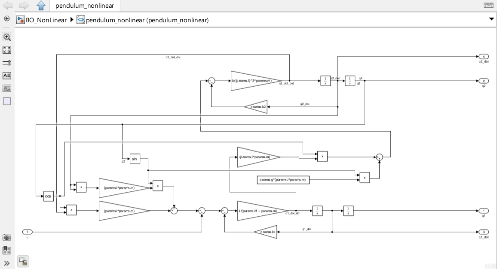

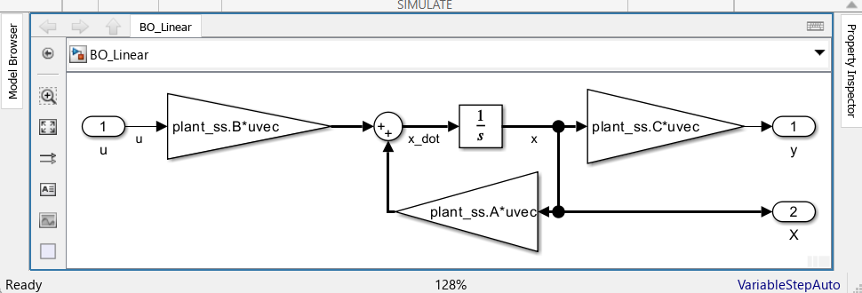

<a id="TMP_5f4a"></a>

## 4. System analysis
<a id="TMP_1ab7"></a>
 

<a id="TMP_13e9"></a>

### Stability

```matlab
[plant_ss, plant_tf, plant_zpk] = syst_repr_generator(params, 'q2');


poles_syst = pole(plant_ss)
```

```matlabTextOutput
poles_syst = 4x1


-3.6308    
3.6025     
-0.0050    
0          


```

```matlab
zeros_syst = zero(plant_ss)
```

```matlabTextOutput
zeros_syst = 2x1
1.0e+-16
0.4043    
0         


```

```matlab
clf("reset")
figure
pzmap(plant_ss)
```


```matlab
[plant_ss, plant_tf, plant_zpk] = syst_repr_generator(params, 'q1');
zeros_syst = zero(plant_ss)
```

```matlabTextOutput
zeros_syst = 2x1


3.1221     
-3.1421    


```

The system is unstable because the second pole of the system is a real positive.

The transfer function from u to q2 has a zero at the origin (s = 0). It cancels the open\-loop pole at the origin, which is why the reduced transfer function has 3 poles and 1 zero. From u to the cart position q1 there is a right\-half\-plane zero at s=3.1221, so the system is non\-minimum phase with respect to q1.

<a id="TMP_2110"></a>
```matlab
[plant_ss, plant_tf, plant_zpk] = syst_repr_generator(params, 'q2');


clf("reset")
figure 
rlocus(plant_ss)
```

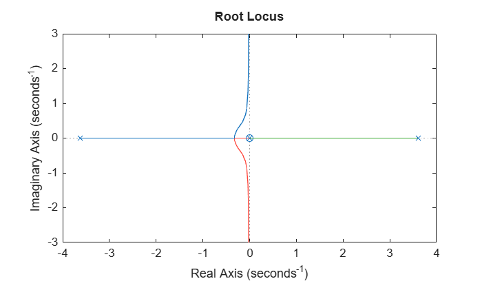

 $$ O\;L\;\left(s\right)=\frac{N}{D}\;\;\;;P\;\mathrm{ctrl}\;;\Rightarrow C\;L\;\left(s\right)=\frac{P\;N}{D+P\;N\;\;} $$ 

A proportional controller alone cannot stabilize the system. The transfer function has 3 poles and 1 zero, located at the origin. As the gain increases, the unstable pole (s = +3.60) moves along the real axis towards that zero, so it never enters the left half\-plane. Therefore no finite P gain can stabilize the system.

<a id="TMP_44e2"></a>
<a id="TMP_4085"></a>

### Controllability and observability

```matlab
run parameters.m
[plant_ss_q1] = syst_repr_generator(params,'q1');
[plant_ss_q2] = syst_repr_generator(params,'q2');
plant_ss = plant_ss_q1;
Qc = ctrb(plant_ss);


rc = rank(Qc)
```

```matlabTextOutput
rc = 4
```

```matlab
ro_q1 = rank(obsv(plant_ss_q1))
```

```matlabTextOutput
ro_q1 = 4
```

```matlab
ro_q2 = rank(obsv(plant_ss_q2))
```

```matlabTextOutput
ro_q2 = 3
```

The system is controllable as the rank of the controllability matrix is equal to the dimension of the A. 

 $r_o =3\not= \dim \left(A\right)=4$, the system is not observable when $q_2$ is chosen as the output of the system. However it becomes observable for $q_1$ as output 

```matlab
plant_ss_diag = diagonalize(plant_ss)
```

```matlabTextOutput
plant_ss_diag = 
  A = 
           x1      x2      x3      x4
   x1       0       0       0       0
   x2       0  -3.631       0       0
   x3       0       0   3.602       0
   x4       0       0       0  -0.005
 
  B = 
           u1
   x1     100
   x2  0.3583
   x3  0.3547
   x4    -100
 
  C = 
             x1        x2        x3        x4
   y1         1  -0.06448   0.06479         1
 
  D = 
       u1
   y1   0
 
Continuous-time state-space model.
Model Properties
```

By diagonalizing the LTI model, we can directly see that all the states are controllable as B matrix is full. 

<a id="TMP_0911"></a>

## 5.Control 
<a id="TMP_565c"></a>

### Loop shaping with PID controller 
1. **u to q2  (q2 as output)**

In this section simulink Control System Designer tool is used to tune a PID controller that stabilize the pendulum. 

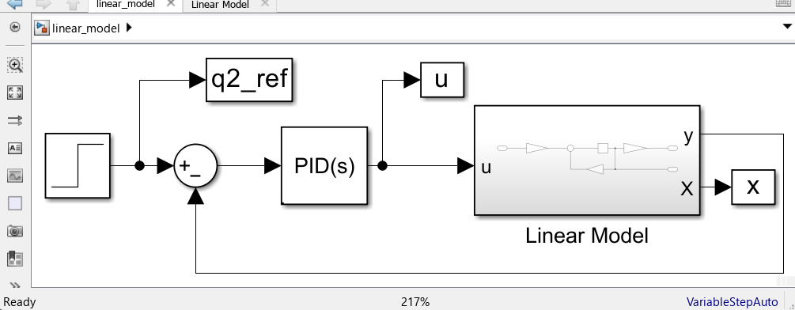

For the simulation $q_{20} =10°$ 

```matlab
Tsim = 10;
Ts = 1e-4;
q2_f = deg2rad(-10);
params.IC = [0,deg2rad(1),0,0];
model = 2; % 1 : linear model,   2: non linear model  , 3: Matlab fct non linear model
[plant_ss] = syst_repr_generator(params,'q2');
input_select = plant_ss.C(1:2);
sim("models/mdl_with_PID.slx");
```

```matlabTextOutput
Warning: Model 'mdl_with_PID' contains 1 algebraic loops. 
Suggested Actions:
    • Highlight and view information about the algebraic loops in the model using the Simulink.BlockDiagram.getAlgebraicLoops function. - Open
    • Suppress this diagnostic by setting the 'Algebraic Loop' diagnostic parameter to 'none'. - Fix


```

```matlab
refs = {'q1_ref', 'q2_ref'};


X = states_from_log(x);              
animate_pendulum_cart(x.Time, X(:,1), X(:,2), u.Data, params, 'fps', 100, ...
    string(refs(input_select==1)), ref.Data*input_select', 'model', model);
```


By using simulink blocks to model the non\-linear system, we encounter algebraic loops because ${\ddot{q} }_1$ requires  ${\ddot{q} }_2$ and vice\-versa. To solve that, we will use Matlab function block (src/pendulum\_cart\_nl.m), to solve the following ode. 

 $$ \left\lbrace \begin{array}{ll} \;\left(M+m\right)\ddot{\;q_1 } -m\;l\ddot{\;q_2 } \;\cos \left(q_2 \right)+m\;l\;{\dot{q_2 } }^2 \;\sin \left(q_2 \right)+k_1 \;\dot{\;q_1 }  & =u\newline -m\;l\;\ddot{\;q_1 } \;\cos \left(q_2 \right)+m\;l^{2\;} \ddot{\;q_2 } -m\;g\;l\;\sin \left(q_2 \right)+k_2 \;\dot{\;q_2 } \; & =0 \end{array}\;\;\;\;\;=\Rightarrow \left\lbrace \begin{array}{ll} \;\left(M+m\right)\ddot{\;q_1 } -m\;l\ddot{\;q_2 } \;\cos \left(q_2 \right) & =u-m\;l\;{\dot{q_2 } }^2 \;\sin \left(q_2 \right)-k_1 \;\dot{\;q_1 } \newline -m\;l\;\ddot{\;q_1 } \;\cos \left(q_2 \right)+m\;l^{2\;} \ddot{\;q_2 } \; & =m\;g\;l\;\sin \left(q_2 \right)-k_2 \;\dot{\;q_2 }  \end{array}\;\;\;\;\;\;\right.\right. $$ 

 $$ \left\lbrack \begin{array}{c} \ddot{\;q_1 } \newline \ddot{\;q_2 }  \end{array}\right\rbrack ={\left\lbrack \begin{array}{cccc} \left(M+m\right) & -m\;l\;\cos \left(q_2 \right)\newline -m\;l\;\cos \left(q_2 \right) & m\;l^{2\;}  \end{array}\right\rbrack }^{-1} \;\left\lbrack \begin{array}{c} \dot{\;u-m\;l\;{\dot{q_2 } }^2 \;\sin \left(q_2 \right)-k_1 \;\dot{\;q_1 } } \newline \dot{\;m\;g\;l\;\sin \left(q_2 \right)-k_2 \;\dot{\;q_2 } }  \end{array}\right\rbrack $$ 

<a id="TMP_130c"></a>

### Model validation
- **Open\-loop fall test**

```matlab
run parameters.m
x0 = [0; deg2rad(0.5); 0; 0];
[t, x] = ode45(@(t,x) pendulum_cart_nl(x, 0, params), [0 50], x0);
clf("reset")
figure
plot(t, rad2deg(x(:,2))); grid on; xlabel('t [s]'); ylabel('q_2 [deg]')
```


We can see that $q_2$ is near 0 at about 1s, and then starts swinging with more and more low amplitude around 180°. 

- **linear vs nonlinear at small angle**

```matlab


plant = syst_repr_generator(params, 'q2');
t  = linspace(0, 0.8, 801)';
[~, ~, xl] = initial(plant, x0, t);
[~, xn]    = ode45(@(t,x) pendulum_cart_nl(x, 0, params), t, x0);
clf("reset")
figure
plot(t, rad2deg(xl(:,2)), t, rad2deg(xn(:,2)), '--'); 
legend('linear', 'nonlinear'); xlabel('t [s]'); ylabel('q_2 [deg]')
```

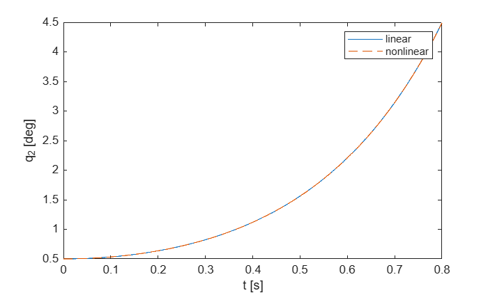

```matlab
relErr = abs(xn(end,2) - xl(end,2)) / abs(xl(end,2))
```

```matlabTextOutput
relErr = 6.6129e-04
```

Linear and non\-linear q2 output perfectly overlay with a relative error nearly null. 

- **Linear model (variant 1) vs block model (variant 2) vs MATLAB Function (variant 3)**

```matlab
run parameters.m
plant_ss = syst_repr_generator(params, 'q2');
input_select = plant_ss.C(1:2);
Tsim = 10;  Ts = 1e-4;  q2_f = deg2rad(-10);
params.IC = [0, deg2rad(1), 0, 0];
clf("reset")
figure; hold on; grid on
for model = 1:3                       % 1 linear, 2 blocks, 3 MATLAB Function
    out = sim("mdl_with_PID");
    X = states_from_log(x);
    Xs{model} = X;
    plot(x.Time, rad2deg(X(:,2)), 'DisplayName', "model " + model)


end
```

```matlabTextOutput
Warning: Model 'mdl_with_PID' contains 1 algebraic loops. 
Suggested Actions:
    • Highlight and view information about the algebraic loops in the model using the Simulink.BlockDiagram.getAlgebraicLoops function. - Open
    • Suppress this diagnostic by setting the 'Algebraic Loop' diagnostic parameter to 'none'. - Fix


```

```matlab
maxDiff_2vs3 = max(abs(rad2deg(Xs{2}(:,2) - Xs{3}(:,2))))   
```

```matlabTextOutput
maxDiff_2vs3 = 0.0192
```

```matlab
maxDiff_1vs3 = max(abs(rad2deg(Xs{1}(:,2) - Xs{3}(:,2))))   
```

```matlabTextOutput
maxDiff_1vs3 = 0.6567
```

```matlab
legend; xlabel('t [s]'); ylabel('q_2 [deg]')
```

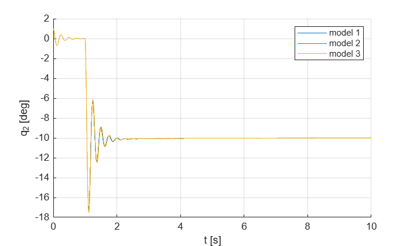

The nonlinear model was implemented twice: as a Simulink block diagram and as a MATLAB Function solving the mass\-matrix form of the Lagrange equations. Under the same PID scenario (q₂₀ = 1°, step to −10°), the two implementations differ by at most 0.019° over 10 s, which confirms both. The linear model differs from them by at most 0.66°, about 4% of the 17° peak, consistent with the small\-angle approximation at that amplitude.

Getting back to PID control this time with MATLAB function based nonlinear model. 

```matlab


Tsim = 10;
Ts = 1e-4;
q2_f = deg2rad(-10);
params.IC = [0,deg2rad(1),0,0];
model = 3; % 1 : linear model,   2: non linear model  , 3: Matlab fct non linear model
[plant_ss] = syst_repr_generator(params,'q2');
input_select = plant_ss.C(1:2);
sim("models/mdl_with_PID.slx");
refs = {'q1_ref', 'q2_ref'};


X = states_from_log(x);              
animate_pendulum_cart(x.Time, X(:,1), X(:,2), u.Data, params, 'fps', 100, ...
    string(refs(input_select==1)), ref.Data*input_select', 'model', model);
```

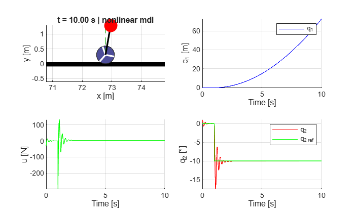

The PID controller assured the pendulum cart to move as desired. Actually holding $q_2$  constant ( ${\dot{q} }_2 =0$ and ${\ddot{\;q} }_2 =0$ ) at \-10° needs a constant acceleration of the cart, ${\ddot{\;q} }_1 =a=-g\ldotp \tan \left(q_2 \right)\approx 1\ldotp 73\;m/s^2$. So the cart position $q_1$ grows like a parabola  ( $\approx 70\;m\;\mathrm{in}\;9\;s$ ) and u settles at  $\left(M+m\right)\cdot a\approx 3\ldotp 5N$ 

- **u to q1 (q1 as output)**

```matlab
Tsim = 10;
Ts = 1e-4;
q2_f = deg2rad(-10);
params.IC = [0,deg2rad(1),0,0];
model = 1; % 1 : linear model,   2: non linear model  , 3: Matlab fct non linear model
[plant_ss] = syst_repr_generator(params,'q1');
input_select = plant_ss.C(1:2);
sim("models/mdl_with_PID.slx");
refs = {'q1_ref', 'q2_ref'};


X = states_from_log(x);              
animate_pendulum_cart(x.Time, X(:,1), X(:,2), u.Data, params, 'fps', 100, ...
    string(refs(input_select==1)), ref.Data*input_select', 'model', model);
```

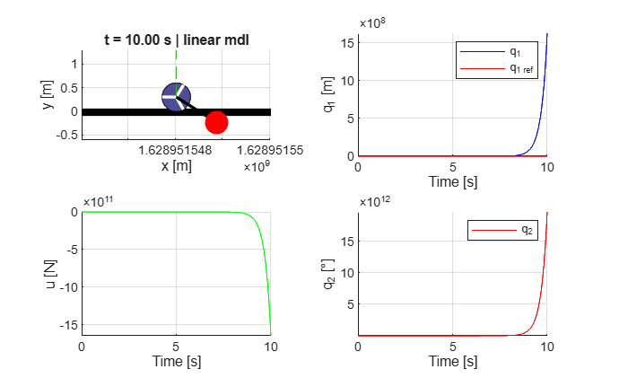

<a id="TMP_7b2d"></a>

### State feedback control

This control law is expressed as $u=-Kx+k_{\mathrm{s}\mathrm{c}\mathrm{a}\mathrm{l}\mathrm{e}} \;y_{\mathrm{r}\mathrm{e}\mathrm{f}}$ 

Classical state feedback controller is only applicable to SISO system, so we have to choose one of the two possible outputs

<a id="TMP_4886"></a>
### State feedback controller with cart position (q\_1) as output 

By default we will set $k_{\mathrm{s}\mathrm{c}\mathrm{a}\mathrm{l}\mathrm{e}} =1$ 

```matlab
[plant_ss]  = syst_repr_generator(params,'q1');
poles_des = [-3, -3, -3, -3];
rank(plant_ss.B);
K = acker(plant_ss.A,plant_ss.B, poles_des);
Tsim = 20;
Ts = 1e-4;
q2_f = deg2rad(10);
params.IC = [0,deg2rad(20),0,0];
model = 3; % 1 : linear model       2: non linear model    3: Matlab fct non linear model
k_scale = 1;
input_select = plant_ss.C(1:2);
refs = {'q1_ref', 'q2_ref'};
sim('models/mdl_with_State_Feedback.slx');
X = states_from_log(x);              
animate_pendulum_cart(x.Time, X(:,1), X(:,2), u.Data, params, 'fps', 100, ...
    string(refs(input_select==1)), ref.Data*input_select', 'model', model);
```

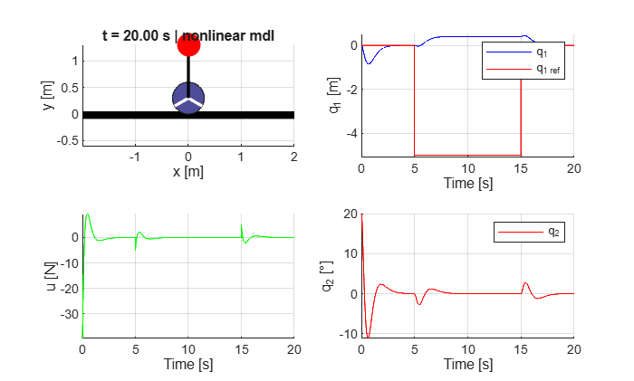

With the compensator $k_{\mathrm{scale}}$ set to default 1, a state feedback controller cannot assure a null static error.

To illustrate the compensator effect, let's consider a simple first order system with a static gain of 0.5. The step plot show a response ceiling at 0.5 instead of 1, the reference. With the compensator, the output is scaled to catch the reference. The same principle is used in state feedback controller.

```matlab
s = zpk('s');
toy_system = 2/(4 + s)
```

```matlabTextOutput
toy_system = 
    2
  -----
  (s+4)
 
Continuous-time zero/pole/gain model.
Model Properties
```

```matlab
clf(gcf)
figure
step(toy_system)
```

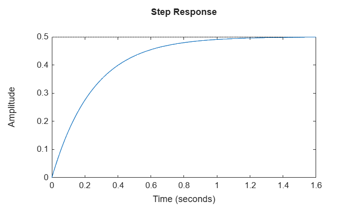

```matlab
figure
clf(gcf)
dcg = dcgain(toy_system)
```

```matlabTextOutput
dcg = 0.5000
```

```matlab
compensator = 1/dcg
```

```matlabTextOutput
compensator = 2
```

```matlab
step(compensator*toy_system)
```

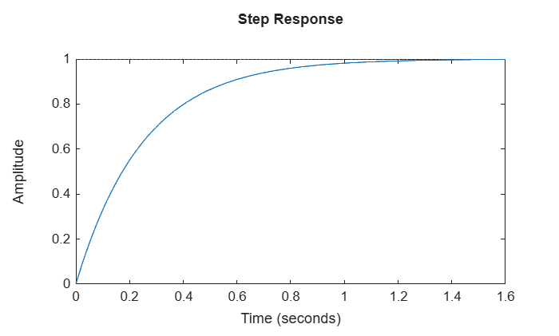

By default we will set $k_{\mathrm{s}\mathrm{c}\mathrm{a}\mathrm{l}\mathrm{e}} =\frac{1}{\mathrm{d}\mathrm{c}\mathrm{g}\mathrm{a}\mathrm{i}\mathrm{n}\left(\mathrm{c}\mathrm{l}\mathrm{o}\mathrm{s}\mathrm{e}\mathrm{d}\;\mathrm{l}\mathrm{o}\mathrm{o}\mathrm{p}\right)}$ 

```matlab
[plant_ss]  = syst_repr_generator(params,'q1');
poles_des = [-3, -3, -3, -3];
rank(plant_ss.B);
K = acker(plant_ss.A,plant_ss.B, poles_des);
Tsim = 20;
Ts = 1e-4;
q2_f = deg2rad(20);
params.IC = [0,deg2rad(20),0,0];
model = 3; % 1 : linear model       2: non linear model    3: Matlab fct non linear model


A_cl = plant_ss.A - plant_ss.B*K;
B_cl = plant_ss.B;
closed_loop_ss =  ss(A_cl, B_cl, plant_ss.C, 0);
[b,a] = ss2tf(A_cl,B_cl, plant_ss.C,0);
closed_loop_tf = tf(b,a)
```

```matlabTextOutput
closed_loop_tf = 
    0.6667 s^2 + 0.01333 s - 6.54
  ----------------------------------
  s^4 + 12 s^3 + 54 s^2 + 108 s + 81
 
Continuous-time transfer function.
Model Properties
```

```matlab
dcg = dcgain(closed_loop_ss);
k_scale = 1/dcg;
input_select = plant_ss.C(1:2);
refs = {'q1_ref', 'q2_ref'};


sim('models/mdl_with_State_Feedback.slx');
clf("reset")
figure;
X = states_from_log(x);              
animate_pendulum_cart(x.Time, X(:,1), X(:,2), u.Data, params, 'fps', 100, ...
    string(refs(input_select==1)), ref.Data*input_select', 'model', model);
```


```matlab
Tsim = 10;
Ts = 1e-4;
q2_f = deg2rad(20);
params.IC = [0,deg2rad(20),0,0];
model = 3; % 1 : linear model       2: non linear model
input_select = plant_ss.C(1:2);
sim('models/mdl_with_State_Feedback.slx');
refs = {'q1_ref', 'q2_ref'};
clf("reset")
figure;
X = squeeze(x.Data);              
if size(X,1) == 4, X = X.'; end  
animate_pendulum_cart(x.Time, X(:,1), X(:,2), u.Data, params, 'fps', 100, ...
    string(refs(input_select==1)), ref.Data*input_select', 'model', model);
```


<a id="TMP_6a4a"></a>
### State feedback controller with swing angle (q\_2) as output 

Taking $q_2$ as output of the system reveals one of the implication of non observability show above. Actually, state feedback control only changes system's poles (the denominator of the the transfer function). Looking closely to the transfer function's numerator when $q_2$ is the output, we notice that $b_0 =-1\ldotp 866e-16\approx 0$. This b0 ≈ 0 is the zero of u → q2 at s = 0: state feedback moves poles, never zeros, which result in $\mathrm{dcgain}=\frac{b_0 }{a_0 }\;$ being null and an infinite compensator $k_{\mathrm{scale}} =\infty$ 

```matlab
[plant_ss]  = syst_repr_generator(params,'q2');
poles_des = [-3, -3, -3, -3];
rank(plant_ss.B);
K = acker(plant_ss.A,plant_ss.B, poles_des);
Tsim = 20;
Ts = 1e-4;
q2_f = deg2rad(20);
params.IC = [0,deg2rad(20),0,0];
model = 3; % 1 : linear model       2: non linear model    3: Matlab fct non linear model


A_cl = plant_ss.A - plant_ss.B*K;
B_cl = plant_ss.B;
closed_loop_ss =  ss(A_cl, B_cl, plant_ss.C, 0);
[b,a] = ss2tf(A_cl,B_cl, plant_ss.C,0);
closed_loop_tf = tf(b,a)
```

```matlabTextOutput
closed_loop_tf = 
  0.6667 s^2 + 1.668e-15 s - 1.866e-16
  ------------------------------------
   s^4 + 12 s^3 + 54 s^2 + 108 s + 81
 
Continuous-time transfer function.
Model Properties
```

```matlab
dcg = dcgain(closed_loop_ss)
```

```matlabTextOutput
dcg = 0
```

```matlab
k_scale = 1/dcg
```

```matlabTextOutput
k_scale = Inf
```

<a id="TMP_2ff7"></a>

### LQR state feedback control

```matlab
[plant_ss]  = syst_repr_generator(params,'q1');
Q = eye(4);       
R  =0.1;
K = lqr(plant_ss.A, plant_ss.B, Q, R);
A_cl = plant_ss.A - plant_ss.B*K;
B_cl = plant_ss.B;
closed_loop =  ss(A_cl, B_cl, plant_ss.C, 0);


dcg = dcgain(closed_loop);
k_scale = 1/dcg;
Tsim = 20;
Ts = 1e-4;
q2_f = deg2rad(10);
params.IC = [0,deg2rad(10),0,0];
model = 3; % 1 : linear model       2: non linear model    3: Matlab fct non linear model


input_select = plant_ss.C(1:2);
sim('models/mdl_with_State_Feedback.slx');
refs = {'q1_ref', 'q2_ref'};


X = states_from_log(x);              
animate_pendulum_cart(x.Time, X(:,1), X(:,2), u.Data, params, 'fps', 100, ...
    string(refs(input_select==1)), ref.Data*input_select', 'model', model);
```

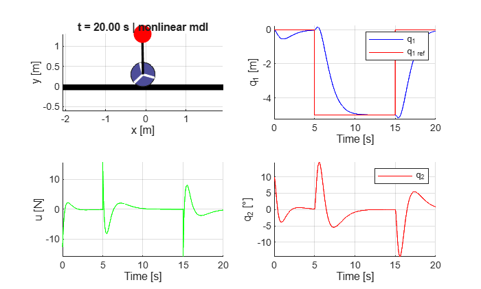

<a id="TMP_6cfa"></a>
<a id="TMP_8d2b"></a>

### Observer based state feedback control

In reality the state are not directly accessible. They are either measured using sensors or estimated with techniques such Luenberger for deterministic systems and Kalman filter for stochastic systems. 

In this exercise will first start with Luenberger observer.

This observer expressed the observed states as : 

 $\dot{x_o } =A{\;x}_o +B\;u\;+L\left(y-y_o \right)$  ; $y_o =C\;x_o \;\;\mathrm{a}\mathrm{n}\mathrm{d}\;y=C\;x$ $\;\Rightarrow \;$ $\dot{\;x_o } =\left(A-L\;C\right)\;x_o +B\;u+L\;y\;$ 

where $y_o \;\mathrm{and}\;y$ are respectively the observed and real output. L is the Luenberger gain that can be calculated via pole placement in order the guaranty a response time of the observer 5 to 10 times faster than the closed loop of the system. 

```matlab


[plant_ss]  = syst_repr_generator(params,'q1');
poles_des = [-4, -3, -2.5, -1.2];
rank(plant_ss.B);
K = acker(plant_ss.A,plant_ss.B, poles_des);
Tsim = 20;
Ts = 1e-4;
q2_f = deg2rad(20);
params.IC = [0,deg2rad(20),0,0];
A_cl = plant_ss.A - plant_ss.B*K;
B_cl = plant_ss.B;
closed_loop =  ss(A_cl, B_cl, plant_ss.C, 0);
obsv_poles = [-15, -16, -17, -18];
L = place(plant_ss.A', plant_ss.C', obsv_poles)';
dcg = dcgain(closed_loop);
k_scale = 1/dcg;
input_select = plant_ss.C(1:2);
refs = {'q1_ref', 'q2_ref'};
model = 3;  % 1 : linear model       2: non linear model    3: Matlab fct non linear model
sim('models/mdl_with_State_Feedback_and_observer.slx');


X = states_from_log(x);              
animate_pendulum_cart(x.Time, X(:,1), X(:,2), u.Data, params, 'fps', 100, ...
    string(refs(input_select==1)), ref.Data*input_select', 'model', model);
```


<a id="TMP_51d0"></a>

### States observer based-LQR State feedback with integral action 
- **u to q2 (q2 as output)**

In order to assure that static error elimination on the pendulum angle, we are going to augment the controller with integral action. 

```matlab
% Augmented system (integral action on q2)
[plant_ss]  = syst_repr_generator(params,'q2');
P = [plant_ss.A, zeros(4,1); -plant_ss.C, 0]; % -C_q2
Rin = [plant_ss.B; 0];
Q = 2*eye(5);
R = 2.5;
K_aug = lqr(P, Rin, Q, R);
P_cl = P - Rin*K_aug;
R_cl = Rin ;
rank(ctrb(P, Rin)) 
```

```matlabTextOutput
ans = 4
```

```matlab
ss_cl =  ss(P_cl, R_cl, [plant_ss.C 0], 0);
pole(ss_cl)
```

```matlabTextOutput
ans = 5x1 complex


-3.9379 + 0.0000i    
-3.3400 + 0.0000i    
-0.5242 + 0.4122i    
-0.5242 - 0.4122i    
-0.0000 + 0.0000i    


```

```matlab


Tsim = 20;
Ts = 1e-4;
params.IC = [0,deg2rad(1),0,0];
model = 3; % 1: linear model       2: non linear model    3: Matlab fct non linear model
input_select = [0,1]; 
q2_f = deg2rad(2);
refs = {"q1_ref", "q2_ref"};
sim('models/mdl_with_State_Feedback_integral.slx');


X = states_from_log(x);              
animate_pendulum_cart(x.Time, X(:,1), X(:,2), u.Data, params, 'fps', 100, ...
    string(refs(input_select==1)), ref.Data*input_select', 'model', model);
```


The plant from u to q₂ has a zero at s = 0. In the augmented system, this zero cancels the pole of the integrator, so the augmented pair (P, Rin) is not controllable (rank 4 instead of 5). LQR can only place the four controllable poles; the uncontrollable mode remains at s = 0 (the −0.0000 pole). As a result, the controller stabilizes the pendulum but cannot make q₂ track the reference: q₂ returns to 0 while the cart drifts at constant speed and the integrator state grows without bound.

Physically, integral action requires a resting state where the output equals its reference, and a controllable augmented system. Neither holds here: holding q₂ ≠ 0 requires a constant cart acceleration, so no resting state exists, and the force acts on the wheel, never directly on the pendulum mass. Integral action is therefore applied to the cart position q₁ instead, where both conditions are met.

- u to q1 (q1 as output)

```matlab


plant_ss = syst_repr_generator(params, 'q1');
P   = [plant_ss.A, zeros(4,1); -plant_ss.C, 0];
Rin = [plant_ss.B; 0];
rank(ctrb(P, Rin))            % must be 5 (it is only 4 with q2)
```

```matlabTextOutput
ans = 5
```

```matlab
Q = 10*eye(5);
R = 2.5;
K_aug = lqr(P, Rin, Q, R);
pole(ss(P - Rin*K_aug, Rin, [plant_ss.C 0], 0))   % all strictly negative
```

```matlabTextOutput
ans = 5x1 complex


-4.4139 + 0.0000i    
-3.0403 + 0.0000i    
-0.9866 + 0.0000i    
-0.7058 + 0.6999i    
-0.7058 - 0.6999i    


```

```matlab
obsv_poles = [-15, -16, -17, -18];
L = place(plant_ss.A', plant_ss.C', obsv_poles)';
Tsim = 20;
Ts = 1e-4;
params.IC = [0,deg2rad(1),0,0];
model = 3; % 1: linear model       2: non linear model    3: Matlab fct non linear model
input_select = plant_ss.C(1:2);
q2_f = deg2rad(10);
refs = {"q1_ref", "q2_ref"};
sim('models/mdl_with_State_Feedback_integral_and_observer.slx')


X = states_from_log(x);              
animate_pendulum_cart(x.Time, X(:,1), X(:,2), u.Data, params, 'fps', 100, ...
    string(refs(input_select==1)), ref.Data*input_select', 'model', model);
```

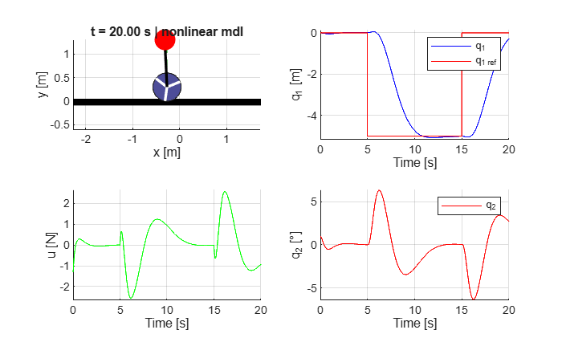

<a id="TMP_1df1"></a>

### Sliding mode control

Sliding mode control is a robust control strategy that aims to drag the system dynamic to a sliding surface $S\left(x\right)=F\;x-r$. The $r$ term is added to follow a reference $y_{\mathrm{ref}}$. 

The adapted reference r is determine as follows: 

On sliding surface $S\left(x_{\infty } \right)=0$ 

 $$ \left\lbrack \begin{array}{c} {\dot{x} }_{\infty } \newline S\left(x_{\infty } \right) \end{array}\right\rbrack =\left\lbrack \begin{array}{cc} A & B\newline F & 0 \end{array}\right\rbrack \left\lbrack \begin{array}{c} x_{\infty } \newline u_{\infty }  \end{array}\right\rbrack +\left\lbrack \begin{array}{c} 0_{n\times 1} \newline -r \end{array}\right\rbrack =\left\lbrack \begin{array}{c} 0_{n\times \;1} \newline 0 \end{array}\right\rbrack $$ 

let $M=\left\lbrack \begin{array}{cc} A & B\newline F & 0 \end{array}\right\rbrack$ 

 $$ \left\lbrack \begin{array}{c} x_{\infty } \newline u_{\infty }  \end{array}\right\rbrack =r\;M^{-1} \left\lbrack \begin{array}{c} 0_{n\times \;1} \newline 1 \end{array}\right\rbrack =r\;\left\lbrack \begin{array}{c} x_t \newline u_t  \end{array}\right\rbrack $$ 

 $$ y_{\mathrm{ref}} =y_{\infty } =C\;x_{\infty } +D\;u_{\infty } =\left(C\;x_t +D\;u_t \right)\;r=\alpha \;r\Longrightarrow r=\frac{y_{\mathrm{ref}} }{\alpha } $$ 

A generalized Ackerman pole placement method is used to calculate $F$, with a resulting Hurwitz caracteristic polynomial 

 $\gamma \left(s\right)={\left(s+p\right)}^{n-k}$    with $n$, the order of the system and $k$, the relative degree that can be arbitrary choosing as long as the condition $k<n$ is met. $p\;$ is the only desired pole to choose. 

 $$ F=e_1 \;Q^{-1} \;\gamma \left(A\right) $$ 

where $Q=\left\lbrack B\;\;\;A\;B\;\;\;\;\ldotp \ldotp \ldotp \;\;A^{n-1} B\right\rbrack$ the controllability matrix and $e_1 =\left\lbrack 0_{1\times \left(n-1\right)} \;\;\;1\right\rbrack$ 

The control law $u\;$ is given as 

 $$ u=-\frac{F\;A^k +f\left(\xi \;\right)}{F\;A^{k-1} \;B} $$ 

 $f\left(\xi \;\right)\;$ is the discontinuous part of the controller chosen here as $f\left(\xi \;\right)=k\_0 \;\tanh \left(\frac{S\left(x\right)}{\phi \;}\right)\;$. 

 $\phi \;$ defines the sliding coridor  

For more details refer to Debbie Hernández, Fernando Castaños, and Leonid Fridman. Pole\-placement in higher\-order sliding\-mode control. In 19th IFAC World Congress, volume 47 of IFAC Proceedings Volumes, pages 1386–1391. IFAC

```matlab
run parameters.m
[plant_ss]  = syst_repr_generator(params,'q1');
Qc = ctrb(plant_ss.A,plant_ss.B);
e = [zeros(1,3) 1];
p = 3;
gamma = (plant_ss.A + p*eye(4))^3;
F = e*inv(Qc)*gamma; 
k0 = 20;
phi = 0.5;
q1_ref = 5; 
params.IC = [0,deg2rad(10),0,0];
q2_f = deg2rad(2);
M = [plant_ss.A, plant_ss.B; F, 0];
x_u_inf = M[zeros(4,1); 1];
alpha = plant_ss.C*x_u_inf(1:end-1);
r = q1_ref/alpha; 
input_select = plant_ss.C(1:2);
Tsim = 20;
Ts=1e-4;
model = 3; % 1 : linear model       2: non linear model    3: Matlab fct non linear model
sim('models/mdl_with_SMC.slx');
refs = {'q1_ref', 'q2_ref'};


X = states_from_log(x);              
animate_pendulum_cart(x.Time, X(:,1), X(:,2), u.Data, params, 'fps', 100, ...
    string(refs(input_select==1)), ref.Data*input_select', 'model', model);
```

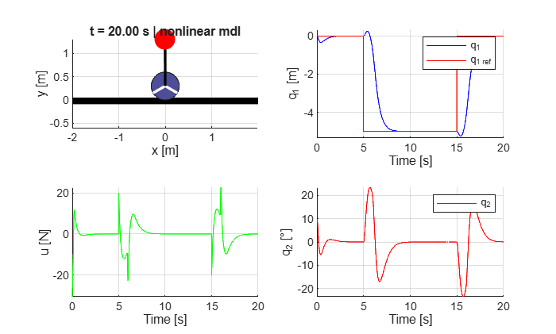

```matlab
run parameters.m
[plant_ss]  = syst_repr_generator(params,'q1');
Qc = ctrb(plant_ss.A,plant_ss.B);
e = [zeros(1,3) 1];
p = 5;
gamma = (plant_ss.A + p*eye(4))^3;
F = e*inv(Qc)*gamma; 
k0 = 50;
phi = 0.5;
q1_ref = 5; 
params.IC = [0,deg2rad(10),0,0];
q2_f = deg2rad(2);
M = [plant_ss.A, plant_ss.B; F, 0];
x_u_inf = M[zeros(4,1); 1];
alpha = plant_ss.C*x_u_inf(1:end-1);
r = q1_ref/alpha; 
input_select = plant_ss.C(1:2);
Tsim = 20;
Ts=1e-4;
model = 3; % 1 : linear model       2: non linear model    3: Matlab fct non linear model
sim('models/mdl_with_SMC.slx');
refs = {'q1_ref', 'q2_ref'};
X = states_from_log(x);              
animate_pendulum_cart(x.Time, X(:,1), X(:,2), u.Data, params, 'fps', 100, ...
    string(refs(input_select==1)), ref.Data*input_select', 'model', model);
```

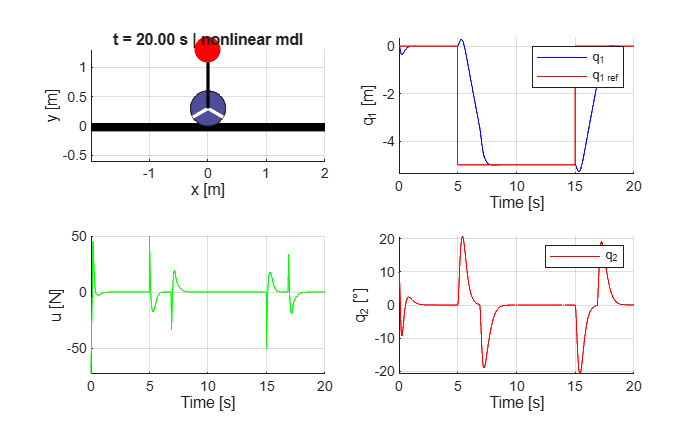

<a id="TMP_71ff"></a>