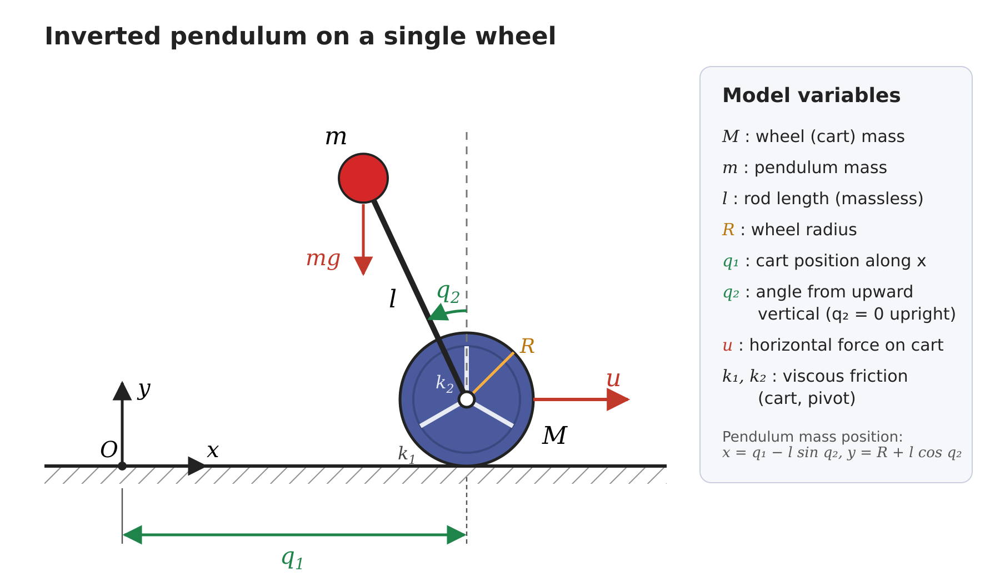
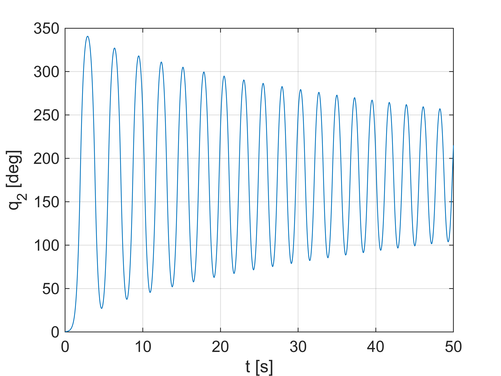
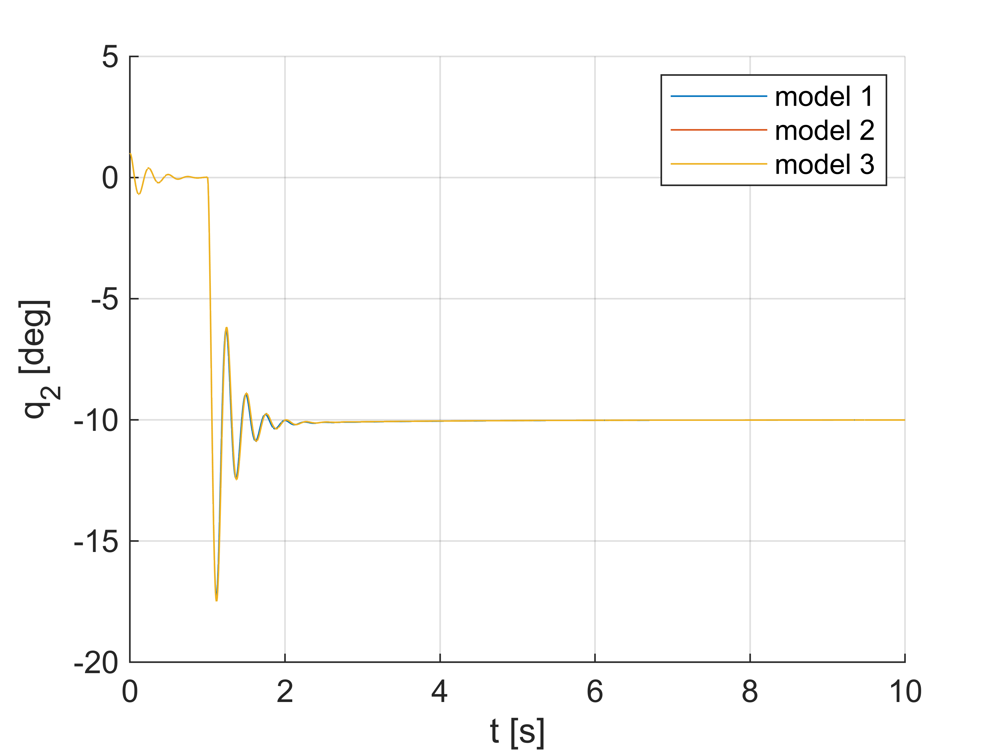
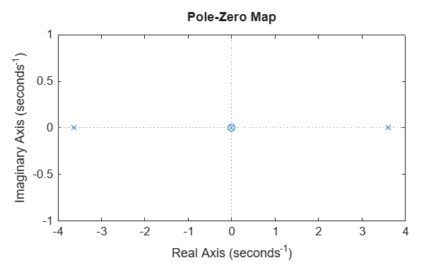
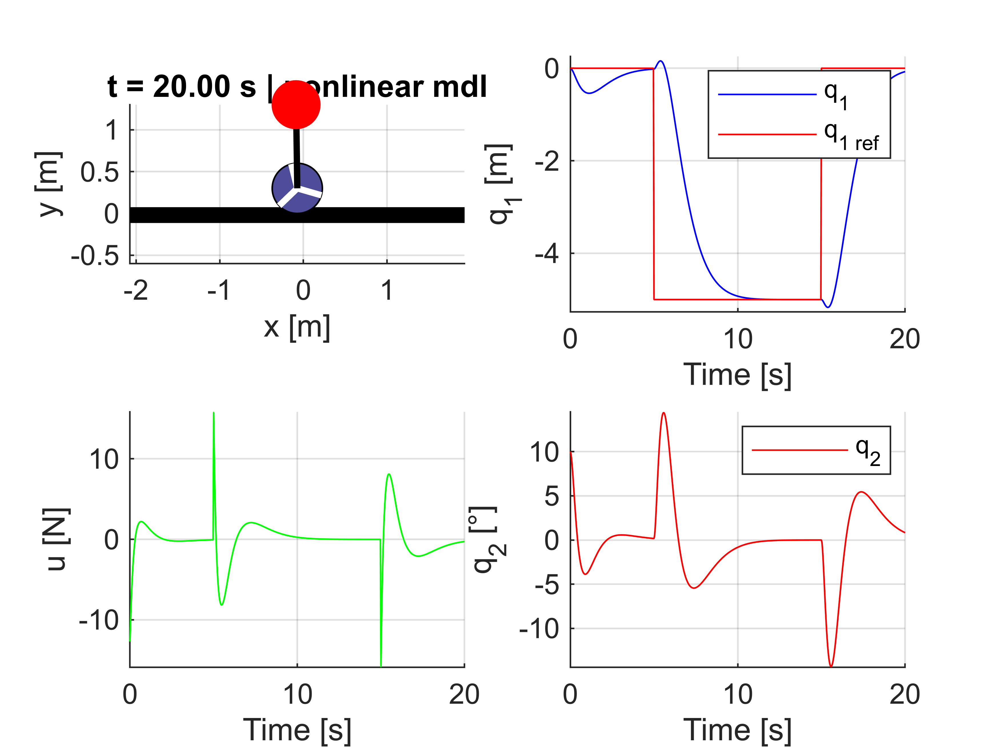
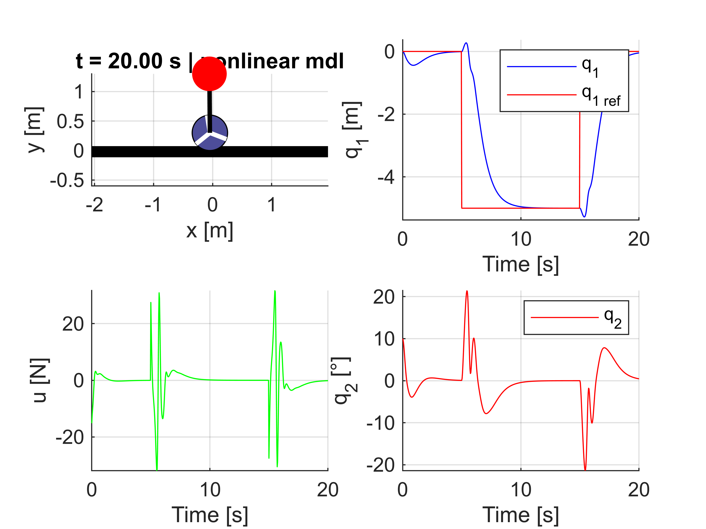
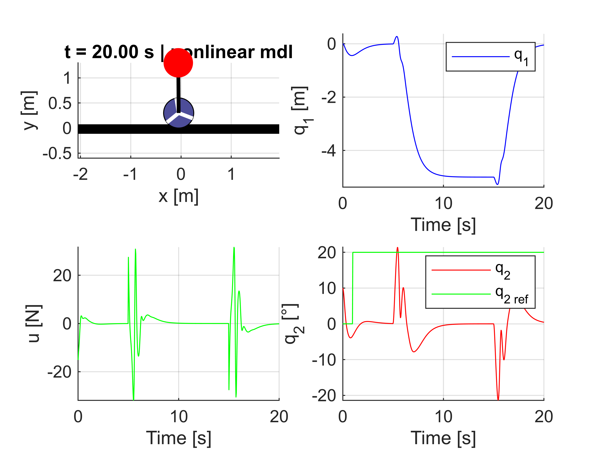
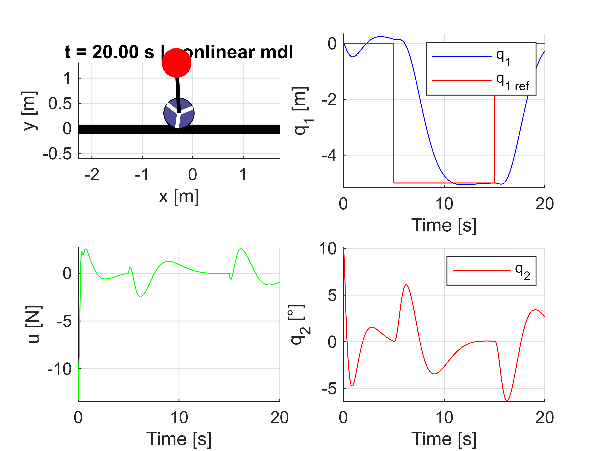

# Pendulum cart control

This report models and controls a single\-wheel inverted pendulum (Segway type): a wheel of mass M carries a pendulum of mass m on a massless rod of length l, and a horizontal force u drives the wheel. The goal is to keep the pendulum upright (q₂ = 0) while moving the wheel to a commanded position q₁. The report derives the nonlinear model, analyses the linearized system, validates the simulation models, then designs and compares five controllers: PID, pole placement, LQR, observer\-based LQR with integral action, and sliding mode control. Unless stated otherwise, every controller is designed on the linear model and tested on the nonlinear one.





# Main results: 
-  The open\-loop system is unstable: one pole at s = +3.60. 
-  u → q₂ has a zero at s = 0. Consequences: no proportional controller stabilizes the pendulum, the reference gain for q₂ is infinite, and integral action on q₂ is impossible. Integral action is therefore placed on q₁. 
-  u → q₁ has a right\-half\-plane zero at s = +3.12: the wheel starts in the wrong direction, by up to 9% of the move (0.46 m before a −5 m move) for the fastest design. The faster the response, the larger this undershoot. 
-  The state is observable from q₁ (rank 4) but not from q₂ alone (rank 3), so the observer measures q₁. 
-  The nonlinear simulation model is validated: two independent implementations agree within 0.019°, and the linear model stays within 0.66° of it at 17°. 
-  The best trade\-off for a real vehicle is LQR with integral action on q₁ and an observer: one sensor, a 2.5 N peak force (25 times less than pole placement) and no steady\-state error, at the cost of a slower move (5.44 s) 

<a name="beginToc"></a>

## Table of Contents
&emsp;[Main results:](#main-results-)
 
&emsp;[1. Model of the system](#1-model-of-the-system)
 
&emsp;&emsp;[2. Model linearization](#2-model-linearization)
 
&emsp;&emsp;[3. Simulink Model of the system](#3-simulink-model-of-the-system)
 
&emsp;&emsp;&emsp;[3.1 Model validation](#3-1-model-validation)
 
&emsp;&emsp;[4. System analysis](#4-system-analysis)
 
&emsp;&emsp;&emsp;[4.1 Stability](#4-1-stability)
 
&emsp;&emsp;&emsp;[4.2 Controllability and observability](#4-2-controllability-and-observability)
 
&emsp;[5.Control](#5-control)
 
&emsp;&emsp;[5.1 PID controller (loop shaping)](#5-1-pid-controller-loop-shaping-)
 
&emsp;[5.2 Pole placement state feedback](#5-2-pole-placement-state-feedback)
 
&emsp;&emsp;&emsp;[5.2.1 State feedback controller with cart position (q\_1) as output](#5-2-1-state-feedback-controller-with-cart-position-q-1-as-output)
 
&emsp;&emsp;&emsp;[5.2.2 State feedback controller with swing angle (q\_2) as output](#5-2-2-state-feedback-controller-with-swing-angle-q-2-as-output)
 
&emsp;&emsp;[5.3 LQR state feedback](#5-3-lqr-state-feedback)
 
&emsp;&emsp;[5.4 Observer\-based state feedback](#5-4-observer-based-state-feedback)
 
&emsp;&emsp;[5.5 Integral action (observer-based LQR)](#5-5-integral-action-observer-based-lqr-)
 
&emsp;&emsp;[5.6 Sliding mode control](#5-6-sliding-mode-control)
 
&emsp;&emsp;[5.7 Comparison](#5-7-comparison)
 
&emsp;[6. Conclusion](#6-conclusion)
 
&emsp;[References](#references)
 
<a name="endToc"></a>


# 1. Model of the system

The system has 2 degrees of freedom q1 and q2. 


Considering the (x,y) frame the position of the masses are given as 

 $$ \left\lbrace \begin{array}{ll} \vec{{\mathrm{O}\mathrm{M}}\;}  & =q_1 \vec{\;x} \newline \vec{\;{\mathrm{O}\mathrm{m}}}  & =\left(q_1 -l\;\sin \left(q_2 \right)\right)\;\vec{x} +l\;\cos \left(q_2 \right)\;\vec{\;y}  \end{array}\right. $$ 


The velocities are:

 $$ \left\lbrace \begin{array}{ll} \frac{d\vec{\;{\mathrm{O}\mathrm{M}}} }{{\mathrm{d}\mathrm{t}}} & =\dot{\;q_1 } \;\vec{\;x} \newline \frac{d\;\vec{\;{\mathrm{O}\mathrm{m}}} }{{\mathrm{d}\mathrm{t}}} & =\left(\dot{\;q_1 } +l\dot{\;q_2 } \;\cos \left(q_2 \right)\right)\vec{\;x} -l{\dot{\;q} }_2 \sin \left(q_2 \right)\;\vec{\;y}  \end{array}\right. $$ 


The kinetic energy of the system is given as 

 $$ \begin{array}{l} T=\frac{1}{2}M\times v_M^2 +\frac{\;1}{2}m\times v_{m\;}^2 =\frac{\;1}{2}M{\dot{\;q_1 } }^2 +\frac{1}{2}{m\left(\left(\dot{\;q_1 } +l\dot{\;q_2 } \;\cos \left(q_2 \right)\right)\vec{\;x} -l{\dot{\;q} }_2 \sin \left(q_2 \right)\;\vec{\;y} \right)}^2 \newline T=\frac{1}{2}\left(M+m\right){\dot{\;q_1 } }^2 +\frac{1}{2}m\left({l^2 \dot{\;q_2 } }^2 -2l\dot{\;q_1 } \dot{\;q_2 } \cos \left(q_2 \right)\right) \end{array} $$ 

The potential energy of the system is produced only by the mass m as the mass M is already grounded. So we have

 $$ V={\mathrm{m}}{\mathrm{g}}{\mathrm{L}}{\mathrm{c}}{\mathrm{o}}{\mathrm{s}}\left(q_2 \right)\; $$ 


From the above energy equations, we obtain the Lagrangian

 $$ L=T-V=\frac{1}{2}\left(M+m\right){\dot{\;q_1 } }^2 +\frac{1}{2}m\left({l^2 \dot{\;q_2 } }^2 -2l\dot{\;q_1 } \dot{\;q_2 } \cos \left(q_2 \right)\right)-{\mathrm{m}\mathrm{g}\mathrm{L}\mathrm{c}\mathrm{o}\mathrm{s}}\left(q_2 \right)\;\; $$ 

As the system is not only conservative. It also has dissipation force (friction of the contact between wheel and ground), generalized Lagrange equations apply as follows: 

 $$ \frac{d}{{\mathrm{d}\mathrm{t}}}\left(\frac{\partial \;L}{\partial \;\dot{\;q_i } }\right)-\frac{\partial \;L}{\partial \;q_i }=Q_i $$ 

Rayleigh dissipation function will be used to introduce the friction force proportional to velocity. 

 $$ R\left(\dot{\;q} \right)=\frac{1}{2}\sum_i^N k_i {\;\dot{\;q_i } }^2 =\frac{1}{2}\;\left(k_1 {\dot{\;q_1 } }^2 +k_2 \;{\dot{\;q_2 } }^2 \right) $$ 

the dissipation force is given as $F_i =-\frac{\partial R}{\partial \dot{\;q_i } }\;\;\;;F_1 =-\frac{\partial R}{\partial \dot{\;q_1 } }=-\frac{1}{2}*\left({2*k}_1 \;\dot{\;q_1 } \right)=-k_1 \;\dot{q_1 }$ 


Thus $Q_i \;=F_i +<{\mathrm{o}\mathrm{t}\mathrm{h}\mathrm{e}\mathrm{r}}\;{\mathrm{e}\mathrm{x}\mathrm{t}\mathrm{e}\mathrm{r}\mathrm{n}\mathrm{a}\mathrm{l}}\;{\mathrm{f}\mathrm{o}\mathrm{r}\mathrm{c}\mathrm{e}\mathrm{s}}\;{\mathrm{a}\mathrm{p}\mathrm{p}\mathrm{l}\mathrm{i}\mathrm{e}\mathrm{d}}\;{\mathrm{t}\mathrm{o}}\;{\mathrm{p}\mathrm{a}\mathrm{r}\mathrm{t}\mathrm{i}\mathrm{c}\mathrm{l}\mathrm{e}}\;i>$ 

-  Lagrange equation w.r.t. $q_1$  

 $$ \frac{d}{{\mathrm{d}\mathrm{t}}}\left(\frac{\partial \;L}{\partial \;\dot{\;q_1 } }\right)-\frac{\partial \;L}{\partial \;q_1 }=-k_1 \;\dot{\;q_1 } +u $$ 

 $\frac{\partial \;L}{\partial \;\dot{\;q_1 } }=\left(M+m\right)\dot{\;q_1 } -m\;l\;\dot{q_2 } \;\cos \left(q_2 \right)\;$ ;   

 $$ \frac{d}{{\mathrm{d}\mathrm{t}}}\left(\frac{\partial \;L}{\partial \;\dot{\;q_1 } }\right)=\left(M+m\right)\ddot{\;q_1 } -m\;l\ddot{\;q_2 } \;\cos \left(q_2 \right)+m\;l\;{\dot{q_2 } }^2 \;\sin \left(q_2 \right) $$ 

 $$ \frac{\partial \;L}{\partial \;q_1 }=0 $$ 

 $$ \Rightarrow \frac{d}{{\mathrm{d}\mathrm{t}}}\left(\frac{\partial \;L}{\partial \;\dot{\;q_1 } }\right)-\frac{\partial \;L}{\partial \;q_1 }=-k\;\dot{\;q_1 } \;\;\Rightarrow \left(M+m\right)\ddot{\;q_1 } -m\;l\ddot{\;q_2 } \;\cos \left(q_2 \right)+m\;l\;{\dot{q_2 } }^2 \;\sin \left(q_2 \right)+k_1 \;\dot{\;q_1 } =u $$ 

-  Lagrange equation w.r.t. $q_2$ 

 $$ \;\Rightarrow -m\;l\;\ddot{\;q_1 } \;\cos \left(q_2 \right)+m\;l^{2\;} \ddot{\;q_2 } -m\;g\;l\;\sin \left(q_2 \right)=-k_2 \;\dot{\;q_2 } \; $$ 


The model of the system is given as 

 $$ \left\lbrace \begin{array}{ll} \;\left(M+m\right)\ddot{\;q_1 } -m\;l\ddot{\;q_2 } \;\cos \left(q_2 \right)+m\;l\;{\dot{q_2 } }^2 \;\sin \left(q_2 \right)+k_1 \;\dot{\;q_1 }  & =u\newline -m\;l\;\ddot{\;q_1 } \;\cos \left(q_2 \right)+m\;l^{2\;} \ddot{\;q_2 } -m\;g\;l\;\sin \left(q_2 \right)+k_2 \;\dot{\;q_2 } \; & =0 \end{array}\right. $$ 

## 2. Model linearization

 

 $$ \begin{array}{l} q_2 \approx 0\approx \epsilon \;\newline \dot{\;q_2 \;} \approx \epsilon \;\; \end{array} \Rightarrow {\dot{q_2 } }^2 =\epsilon^2 \;\;;{\dot{q_2 } }^2 q_2 =\epsilon^3 =0 $$ 

 $$ q_2 \approx 0\;\Rightarrow \left\lbrace \begin{array}{ll} \cos \left(q_2 \right) & \approx 1\newline \sin \left(q_2 \right) & \approx q_2  \end{array}\right. $$ 

 $$ \Rightarrow \left\lbrace \begin{array}{ll} \;\left(M+m\right)\ddot{\;q_1 } -m\;l\ddot{\;q_2 } \;+k_1 \;\dot{\;q_1 }  & =u\newline -m\;l\;\ddot{\;q_1 } \;+m\;l^{2\;} \ddot{\;q_2 } -m\;g\;l\;q_2 +k_2 \;\dot{\;q_2 } \; & =0 \end{array}\right. $$ 

 $$ \Rightarrow \left\lbrace \begin{array}{cc} \ddot{\;q_1 }  & =\frac{\;m\;l\;}{M+m}\ddot{\;q_2 } -\frac{k_1 }{M+m}\;\dot{\;q_1 } \;+\frac{1}{M+m}u\;\;\;\;\;\;\;\;\;\;\;\newline \ddot{\;q_2 }  & \;=\frac{\;1}{l}\ddot{\;q_1 } -\frac{\;k_2 }{m\;l^2 }\dot{\;q_2 } +\frac{\;g}{l}q_2 \;\;\;\;\;\;\;\;\;\;\;\;\;\;\;\;\;\;\;\;\;\;\;\;\;\;\;\;\;\;\;\;\;\;\;\;\;\;\; \end{array}\right. $$ 

 $$ \Rightarrow \left\lbrace \begin{array}{cc} \ddot{\;q_1 } = & \frac{\;m\;}{M+m}\ddot{\;q_1 } \;-\frac{k_2 }{\left(M+m\right)l}\dot{\;q_2 } \;+\frac{\;m\;g}{\left(M+m\right)}q_2 \;-\frac{k_1 }{M+m}\dot{\;q_1 } +\frac{1}{M+m}u\newline \ddot{\;q_2 } = & \frac{\;m}{M+m}\ddot{\;q_2 } \;-\frac{\;k_1 }{\left(M+m\right)l}\dot{\;q_1 } -\frac{\;k_2 }{m\;l^2 }\dot{\;q_2 } +\frac{\;g}{l}q_2 +\frac{\;1}{\left(M+m\right)l\;}\;u\;\;\;\;\;\;\;\;\;\;\;\;\;\;\;\;\;\;\;\;\;\;\;\;\;\;\;\;\;\;\;\;\;\;\; \end{array}\right. $$ 

 $$ \Rightarrow \left\lbrace \begin{array}{cc} M\ddot{\;q_1 } = & -k_1 \dot{\;q_1 } -\frac{k_2 }{l}\dot{\;q_2 } \;+m\;g\;q_2 \;+u\;\;\;\;\;\;\;\;\;\;\;\;\;\;\;\;\;\;\;\;\;\;\;\;\;\;\;\;\;\;\;\;\;\;\;\;\;\;\;\;\;\;\;\;\;\;\;\newline M\ddot{\;q_2 } = & \;-\frac{\;k_1 }{l}\dot{\;q_1 } -\frac{\left(M+m\right)\;k_2 }{m\;l^2 }\dot{\;q_2 } +\frac{\;\left(M+m\right)g}{l}q_2 +\frac{1}{l}u\; \end{array}\right. $$ 

 $$ \Rightarrow \left\lbrace \begin{array}{cc} \ddot{\;q_1 } = & -\frac{k_1 }{M}\dot{\;q_1 } -\frac{k_2 }{M\;l\;}\dot{\;q_2 } \;+\frac{\;m\;g}{M\;}q_2 \;+\frac{\;1}{M}u\;\;\;\;\;\;\;\;\;\;\;\;\;\;\;\;\;\;\;\;\;\;\;\;\;\;\;\;\;\;\;\;\;\;\;\;\;\;\;\;\;\;\newline \ddot{\;q_2 } = & \;-\frac{\;k_1 }{M\;l}\dot{\;q_1 } -\frac{\left(M+m\right)\;k_2 }{M\;m\;l^2 }\dot{\;q_2 } +\frac{\;\left(M+m\right)g}{M\;l}q_2 +\frac{1}{M\;l}u\;\; \end{array}\right. $$ 

 $$ \; $$ 

 $$ \Rightarrow \left\lbrace \begin{array}{ll} \dot{\;q_1 }  & =\dot{\;q_1 } \newline \dot{\;q_2 }  & =\dot{\;q_2 } \newline \ddot{\;q_1 }  & =-\frac{k_1 }{M}\dot{\;q_1 } -\frac{k_2 }{M\;l}\dot{\;q_2 } \;+\frac{\;m\;g}{M\;l}q_2 \;+\frac{\;1}{M\;}u\newline \ddot{\;q_2 }  & =\;-\frac{\;k_1 }{M\;l}\dot{\;q_1 } -\frac{\left(M+m\right)\;k_2 }{M\;m\;l^2 }\dot{\;q_2 } +\frac{\;\left(M+m\right)g}{M\;l}q_2 +\frac{1}{M\;l}u\;\;\;\;\; \end{array}\;\right. $$ 

 $$ \left\lbrack \begin{array}{c} \dot{\;q_1 } \newline \dot{\;q_2 } \newline \ddot{\;q_1 } \newline \ddot{\;q_2 }  \end{array}\right\rbrack =\left\lbrack \begin{array}{cccc} 0 & 0 & 1 & 0\newline 0 & 0 & 0 & 1\newline 0 & \frac{\;m\;g}{M\;} & -\frac{\;k_1 }{M} & -\frac{\;k_2 }{M\;l}\newline 0 & \frac{\;\left(M+m\right)g}{M\;l} & -\frac{\;k_1 }{M\;l} & -\frac{\left(M+m\right)\;k_2 }{M\;m\;l^2 } \end{array}\right\rbrack \left\lbrack \begin{array}{c} q_1 \newline q_2 \newline \dot{\;q_1 } \newline \dot{\;q_2 }  \end{array}\right\rbrack +\left\lbrack \begin{array}{c} 0\newline 0\newline \frac{\;1}{M\;}\newline \frac{1}{M\;l} \end{array}\right\rbrack u $$ 

```matlab
clear all;
close all;
```

```matlab

ctrl_names = {};
ctrl_metrics = [];
```

## 3. Simulink Model of the system

The following values will taken for the system parameters


 $M=1\ldotp 5\;{\mathrm{k}\mathrm{g}}\;,m=0\ldotp 5\;{\mathrm{k}\mathrm{g}},\;g=9\ldotp 81\;m/s\;,\;l=1\;m,{\;k}_1 =k_2 =0\ldotp 01$ , 


Unless stated otherwise, the measured output is the pendulum angle, *y*=*q*2.

```matlab
run("parameters.m");
[plant_ss, plant_tf, plant_zpk] = syst_repr_generator(params, 'q2');
plant_ss.StateName = {'q_1', 'q_2', '\dot{q_1}', '\dot{q_2}'}; 
q20 = 10;
Tsim = 10;
% plant_ss
plant_tf
```

```matlabTextOutput
plant_tf =
 
     0.6667 s^2 + 1.4e-17 s + 6.598e-16
  ----------------------------------------
  s^4 + 0.03333 s^3 - 13.08 s^2 - 0.0654 s
 
Continuous-time transfer function.
Model Properties
```

```matlab
dcgain(plant_tf)
```

```matlabTextOutput
ans = Inf
```

```matlab
plant_zpk
```

```matlabTextOutput
plant_zpk =
 
            0.66667 s
  -----------------------------
  (s+3.631) (s-3.602) (s+0.005)
 
Continuous-time zero/pole/gain model.
Model Properties
```


### 3.1 Model validation

The nonlinear model is implemented in two ways. A block diagram of the Lagrange equations creates an algebraic loop, because *¨q*1 requires *¨q*2 and vice versa. The second implementation removes the loop by solving the mass\-matrix form in a MATLAB Function block (src/pendulum\_cart\_nl.m)

 $$ \left\lbrace \begin{array}{ll} \;\left(M+m\right)\ddot{\;q_1 } -m\;l\ddot{\;q_2 } \;\cos \left(q_2 \right) & =u-m\;l\;{\dot{q_2 } }^2 \;\sin \left(q_2 \right)-k_1 \;\dot{\;q_1 } \newline -m\;l\;\ddot{\;q_1 } \;\cos \left(q_2 \right)+m\;l^{2\;} \ddot{\;q_2 } \; & =m\;g\;l\;\sin \left(q_2 \right)-k_2 \;\dot{\;q_2 }  \end{array}\;\;\;\;\;\;\right. $$ 

 $$ \left\lbrack \begin{array}{c} \ddot{\;q_1 } \newline \ddot{\;q_2 }  \end{array}\right\rbrack ={\left\lbrack \begin{array}{cccc} \left(M+m\right) & -m\;l\;\cos \left(q_2 \right)\newline -m\;l\;\cos \left(q_2 \right) & m\;l^{2\;}  \end{array}\right\rbrack }^{-1} \;\left\lbrack \begin{array}{c} \dot{\;u-m\;l\;{\dot{q_2 } }^2 \;\sin \left(q_2 \right)-k_1 \;\dot{\;q_1 } } \newline \dot{\;m\;g\;l\;\sin \left(q_2 \right)-k_2 \;\dot{\;q_2 } }  \end{array}\right\rbrack $$ 

Three checks are made: an open\-loop fall test, a small\-angle comparison with the linear model, and a comparison of the three plant models in closed loop with the PID of section 5.1.

-  **Open\-loop fall test**  
```matlab
run("parameters.m")
x0 = [0; deg2rad(0.5); 0; 0];
[t, x] = ode45(@(t,x) pendulum_cart_nl(x, 0, params), [0 50], x0);
clf("reset")
figure
plot(t, rad2deg(x(:,2))); grid on; xlabel('t [s]'); ylabel('q_2 [deg]')
```



*Figure 1: Open\-loop fall test of the nonlinear model, q₂(0) = 0.5°, u = 0.*


Released at 0.5° with u = 0, the pendulum stays near the top for about 1 s, then falls and oscillates around the hanging position (±180°) with an amplitude that slowly decreases because of the pivot friction k₂. The model reproduces the expected physical behaviour.


-  **linear vs nonlinear at small angle** 
```matlab

plant = syst_repr_generator(params, 'q2');
t  = linspace(0, 0.8, 801)';
[~, ~, xl] = initial(plant, x0, t);
[~, xn]    = ode45(@(t,x) pendulum_cart_nl(x, 0, params), t, x0);
clf("reset")
figure
plot(t, rad2deg(xl(:,2)), t, rad2deg(xn(:,2)), '--'); 
legend('linear', 'nonlinear'); xlabel('t [s]'); ylabel('q_2 [deg]')
```


*Figure 2: Linear vs nonlinear model, open loop, q₂(0) = 0.5°.*

```matlab
relErr = abs(xn(end,2) - xl(end,2)) / abs(xl(end,2))
```

```matlabTextOutput
relErr = 6.6129e-04
```

Over the first 0.8 s, the linear and nonlinear responses overlap: the relative error at t = 0.8 s is 0.066%.


-  **Linear model (variant 1) vs block model (variant 2) vs MATLAB Function (variant 3)** 
```matlab
run("parameters.m")
plant_ss = syst_repr_generator(params, 'q2');
input_select = plant_ss.C(1:2);
Tsim = 10;  Ts = 1e-4;  q2_f = deg2rad(-10);
params.IC = [0, deg2rad(1), 0, 0];
clf("reset")
figure; hold on; grid on
for model = 1:3                       % 1 linear, 2 blocks, 3 MATLAB Function
    out = sim("mdl_with_PID");
    X = states_from_log(x);
    Xs{model} = X;
    plot(x.Time, rad2deg(X(:,2)), 'DisplayName', "model " + model)

end
```

```matlabTextOutput
Warning: Model 'mdl_with_PID' contains 1 algebraic loops. 
Suggested Actions:
    • Highlight and view information about the algebraic loops in the model using the Simulink.BlockDiagram.getAlgebraicLoops function. - Open
    • Suppress this diagnostic by setting the 'Algebraic Loop' diagnostic parameter to 'none'. - Fix

Found algebraic loop that contains: 
mdl_with_PID/Variant Subsystem plant/Non-linear model/Subsystem Reference/Sum7
mdl_with_PID/Variant Subsystem plant/Non-linear model/Subsystem Reference/Sum8
mdl_with_PID/Variant Subsystem plant/Non-linear model/Subsystem Reference/Gain12
mdl_with_PID/Variant Subsystem plant/Non-linear model/Subsystem Reference/Gain13
mdl_with_PID/Variant Subsystem plant/Non-linear model/Subsystem Reference/Divide3
mdl_with_PID/Variant Subsystem plant/Non-linear model/Subsystem Reference/Sum9
mdl_with_PID/Variant Subsystem plant/Non-linear model/Subsystem Reference/Sum10
mdl_with_PID/Variant Subsystem plant/Non-linear model/Subsystem Reference/Gain8
mdl_with_PID/Variant Subsystem plant/Non-linear model/Subsystem Reference/Divide
mdl_with_PID/Variant Subsystem plant/Non-linear model/Subsystem Reference/Gain9
mdl_with_PID/Variant Subsystem plant/Non-linear model/Subsystem Reference/Sum (algebraic variable)
```

```matlab
maxDiff_2vs3 = max(abs(rad2deg(Xs{2}(:,2) - Xs{3}(:,2))))   
```

```matlabTextOutput
maxDiff_2vs3 = 0.0192
```

```matlab
maxDiff_1vs3 = max(abs(rad2deg(Xs{1}(:,2) - Xs{3}(:,2))))   
```

```matlabTextOutput
maxDiff_1vs3 = 0.6567
```

```matlab
legend; xlabel('t [s]'); ylabel('q_2 [deg]')
```



*Figure 3: PID on qâ‚‚ with the three plant models (linear, block diagram, MATLAB Function).*


The nonlinear model was implemented twice: as a Simulink block diagram and as a MATLAB Function solving the mass\-matrix form of the Lagrange equations. Under the same PID scenario (q₂₀ = 1°, step to −10°), the two implementations differ by at most 0.019° over 10 s, which confirms both. The linear model differs from them by at most 0.66°, about 4% of the 17° peak, consistent with the small\-angle approximation at that amplitude.

## 4. System analysis

 

### 4.1 Stability
```matlab
run("parameters.m")
[plant_ss, plant_tf, plant_zpk] = syst_repr_generator(params, 'q2');

poles_syst = pole(plant_ss)
```

```matlabTextOutput
poles_syst = 4x1

    -3.6308
     3.6025
    -0.0050
          0

```

```matlab
zeros_syst = zero(plant_ss)
```

```matlabTextOutput
zeros_syst = 2x1
1.0e+-16

    0.4043
         0

```

```matlab
clf("reset")
figure
pzmap(plant_ss)
```



Figure 4: Open\-loop poles and zeros, u → q₂.

```matlab
[plant_ss, plant_tf, plant_zpk] = syst_repr_generator(params, 'q1');
zeros_syst = zero(plant_ss)
```

```matlabTextOutput
zeros_syst = 2x1

     3.1221
    -3.1421

```

The open\-loop system is unstable: it has a real pole at s = +3.60, so a small tilt grows like e^(3.6 t) and the pendulum falls in about one second. The pole at s = 0 is the free wheel position, and the pole at s = −0.005 is the slow decay of the wheel speed through friction.


The transfer function from u to *q*2 has a zero at the origin (s = 0). It cancels the open\-loop pole at the origin, which is why the reduced transfer function has 3 poles and 1 zero. From u to the cart position *q*1 there is a right\-half\-plane zero at s=3.1221, so the system is non\-minimum phase with respect to q1.

```matlab
[plant_ss, plant_tf, plant_zpk] = syst_repr_generator(params, 'q2');

clf("reset")
figure 
rlocus(plant_ss)
```


*Figure 5: Root locus of u → q₂ under proportional feedback.*

 $$ O\;L\;\left(s\right)=\frac{N}{D}\;\;\;;P\;{\mathrm{c}}{\mathrm{t}}{\mathrm{r}}{\mathrm{l}}\;;\Rightarrow C\;L\;\left(s\right)=\frac{P\;N}{D+P\;N\;\;} $$ 

A proportional controller alone cannot stabilize the system. The transfer function has 3 poles and 1 zero, located at the origin. As the gain increases, the unstable pole (s = +3.60) moves along the real axis towards that zero, so it never enters the left half\-plane. Therefore no finite P gain can stabilize the system.


### 4.2 Controllability and observability
```matlab
run("parameters.m")
[plant_ss_q1] = syst_repr_generator(params,'q1');
[plant_ss_q2] = syst_repr_generator(params,'q2');
plant_ss = plant_ss_q1;
Qc = ctrb(plant_ss);

rc = rank(Qc)
```

```matlabTextOutput
rc = 4
```

```matlab
ro_q1 = rank(obsv(plant_ss_q1))
```

```matlabTextOutput
ro_q1 = 4
```

```matlab
ro_q2 = rank(obsv(plant_ss_q2))
```

```matlabTextOutput
ro_q2 = 3
```


The controllability matrix has rank 4 = n: the single input u can drive every state. The observability matrix has rank 4 with y = q₁ but only 3 with y = q₂: the wheel position cannot be reconstructed from the angle, because the angle dynamics do not depend on where the wheel is. Every observer in this report therefore measures q₁.

```matlab
plant_ss_diag = diagonalize(plant_ss)
```

```matlabTextOutput
plant_ss_diag = 
  A = 
           x1      x2      x3      x4
   x1       0       0       0       0
   x2       0  -3.631       0       0
   x3       0       0   3.602       0
   x4       0       0       0  -0.005
 
  B = 
           u1
   x1     100
   x2  0.3583
   x3  0.3547
   x4    -100
 
  C = 
             x1        x2        x3        x4
   y1         1  -0.06448   0.06479         1
 
  D = 
       u1
   y1   0
 
Continuous-time state-space model.
Model Properties
```

In modal form, the eigenvalues are distinct and every entry of B is non\-zero, so the input reaches every mode. This confirms controllability.


# 5.Control 

All controllers are designed on the linear model and simulated on the nonlinear model (MATLAB Function, model = 3) unless stated otherwise. Section 5.7 compares them on the same scenario.5.1 PID controller (loop shaping)

## 5.1 PID controller (loop shaping)

-  **u to q2  (q2 as output)** 

The PID is tuned on the loop u → q₂ with Control System Designer. Gains: *Kp*=830.80 , *Ki*=430.55 , *Kd*=14.79; phase margin 0.481deg at a crossover of 2.99*rad*/*s*.


The simulation starts at q₂(0) = 1° and commands a step to −10° at t = 1 s.


The PID is simulated on the validated nonlinear model (MATLAB Function).


```matlab
run("parameters.m")
Tsim = 10;
Ts = 1e-4;
q2_f = deg2rad(-10);
params.IC = [0,deg2rad(10),0,0];
model = 3; % 1 : linear model,   2: non linear model  , 3: Matlab fct non linear model
[plant_ss] = syst_repr_generator(params,'q2');
input_select = plant_ss.C(1:2);
sim("models/mdl_with_PID.slx");
refs = {'q1_ref', 'q2_ref'};

X = states_from_log(x);              
animate_pendulum_cart(x.Time, X(:,1), X(:,2), u.Data, params, 'fps', 30, ...
    string(refs(input_select==1)), ref.Data*input_select', 'model', model);
```


*Figure 6: PID on q₂, nonlinear model (MATLAB Function), step to −10°.*


The PID holds the pendulum at the commanded −10°.  Holding $q_2$  constant ( ${\dot{q} }_2 =0$ and ${\ddot{\;q} }_2 =0$ ) at \-10° needs a constant acceleration of the cart, ${\ddot{\;q} }_1 =a=-g\ldotp \tan \left(q_2 \right)\approx 1\ldotp 73\;m/s^2$ . So the cart position $q_1$ grows like a parabola  ( $\approx 70\;m\;{\mathrm{i}\mathrm{n}}\;9\;s$ ) and u settles at  $\left(M+m\right)\cdot a\approx 3\ldotp 5N$ 

-  **u to q1 (q1 as output)** 
```matlab
run("parameters.m")
Tsim = 10;
Ts = 1e-4;
q2_f = deg2rad(-10);
model = 1; % 1 : linear model,   2: non linear model  , 3: Matlab fct non linear model
[plant_ss] = syst_repr_generator(params,'q1');
input_select = plant_ss.C(1:2);
sim("models/mdl_with_PID.slx");
refs = {'q1_ref', 'q2_ref'};

X = states_from_log(x);              
animate_pendulum_cart(x.Time, X(:,1), X(:,2), u.Data, params, 'fps', 30, ...
    string(refs(input_select==1)), ref.Data*input_select', 'model', model);
```


*Figure 7: PID with* $q\textrm{₁}$ *as output, linear model: the loop diverges.*


With q₁ as the only measurement, the PID cannot stabilize the system and every state diverges. The reason is structural: from u to q₁ the right\-half\-plane zero (+3.12) lies below the unstable pole (+3.60), with no zero between that pole and infinity. Such a plant can only be stabilized by an unstable controller (parity interlacing property), so no classical PID on $q\textrm{₁}$ alone can do it. Balancing requires feedback on the angle, which is what the state\-feedback controllers below provide.

# 5.2 Pole placement state feedback

This control law is expressed as $u=-Kx+k_{{\mathrm{s}}{\mathrm{c}}{\mathrm{a}}{\mathrm{l}}{\mathrm{e}}} \;y_{{\mathrm{r}}{\mathrm{e}}{\mathrm{f}}}$ 


The state feedback $u=-Kx$ uses all four states, whatever the output. The output only matters for reference tracking: the gain $k_{{\mathrm{s}\mathrm{c}\mathrm{a}\mathrm{l}\mathrm{e}}} =1/G_{{\mathrm{c}\mathrm{l}}} (0)$ makes one chosen output follow its reference in steady state. Two choices are studied: $y=q\textrm{₁}$ and $y=q\textrm{₂}$ .


### 5.2.1 State feedback controller with cart position (q\_1) as output

By default we will set $k_{{\mathrm{s}}{\mathrm{c}}{\mathrm{a}}{\mathrm{l}}{\mathrm{e}}} =1$ 

```matlab
run("parameters.m")
[plant_ss]  = syst_repr_generator(params,'q1');
poles_des = [-3, -3, -3, -3];
rank(plant_ss.B);
K = acker(plant_ss.A,plant_ss.B, poles_des);
Tsim = 20;
Ts = 1e-4;
q2_f = deg2rad(10);
model = 3; % 1 : linear model       2: non linear model    3: Matlab fct non linear model
k_scale = 1;
input_select = plant_ss.C(1:2);
refs = {'q1_ref', 'q2_ref'};
sim('models/mdl_with_State_Feedback.slx');
X = states_from_log(x);              
animate_pendulum_cart(x.Time, X(:,1), X(:,2), u.Data, ...
    params, 'fps', 30, ...
    string(refs(input_select==1)), ...
```


```matlab
    ref.Data*input_select', 'model', model);
```

*Figure 8: Pole placement (poles at −3), k\_scale = 1, nonlinear model.*


With $k_{{\mathrm{s}\mathrm{c}\mathrm{a}\mathrm{l}\mathrm{e}}} =1$ the loop is stable (four poles at −3), but the closed\-loop DC gain from reference to $q\textrm{₁}$ is $-6\ldotp 54/81\approx -0\ldotp 081$ . The wheel therefore settles at $+0\ldotp 40m$ instead of $-5m$ : the wrong size, and the wrong sign.


To illustrate the compensator effect, let's consider a simple first order system with a static gain of 0.5. The step plot shows a response settling at 0.5 instead of 1, the reference. With the compensator, the output is scaled to catch the reference. The same principle is used in state feedback controller.

```matlab
s = zpk('s');
toy_system = 2/(4 + s)
```

```matlabTextOutput
toy_system =
 
    2
  -----
  (s+4)
 
Continuous-time zero/pole/gain model.
Model Properties
```

```matlab
clf(gcf)
figure
step(toy_system)
```


*Figure 9: Step response of the example system 2/(s + 4).*

```matlab
figure
clf(gcf)
dcg = dcgain(toy_system)
```

```matlabTextOutput
dcg = 0.5000
```

```matlab
compensator = 1/dcg
```

```matlabTextOutput
compensator = 2
```

```matlab
step(compensator*toy_system)
```


*Figure 10: Same system with the static gain compensated.*


By default we will set $k_{{\mathrm{s}}{\mathrm{c}}{\mathrm{a}}{\mathrm{l}}{\mathrm{e}}} =\frac{1}{G_{{\mathrm{c}\mathrm{l}}} \left(0\right)}$ ,  the inverse of the closed\-loop DC gain

```matlab
run("parameters.m")
[plant_ss]  = syst_repr_generator(params,'q1');
poles_des = [-3, -3, -3, -3];
rank(plant_ss.B);
K = acker(plant_ss.A,plant_ss.B, poles_des);
Tsim = 20;
Ts = 1e-4;
q2_f = deg2rad(20);
model = 3; % 1 : linear model       2: non linear model    3: Matlab fct non linear model

A_cl = plant_ss.A - plant_ss.B*K;
B_cl = plant_ss.B;
closed_loop_ss =  ss(A_cl, B_cl, plant_ss.C, 0);
[b,a] = ss2tf(A_cl,B_cl, plant_ss.C,0);
closed_loop_tf = tf(b,a)
```

```matlabTextOutput
closed_loop_tf =
 
    0.6667 s^2 + 0.01333 s - 6.54
  ----------------------------------
  s^4 + 12 s^3 + 54 s^2 + 108 s + 81
 
Continuous-time transfer function.
Model Properties
```

```matlab
dcg = dcgain(closed_loop_ss);
k_scale = 1/dcg;
input_select = plant_ss.C(1:2);
refs = {'q1_ref', 'q2_ref'};

sim('models/mdl_with_State_Feedback.slx');

X = states_from_log(x);              
animate_pendulum_cart(x.Time, X(:,1), X(:,2), u.Data, ...
    params, 'fps', 30, ...
    string(refs(input_select==1)), ...
    ref.Data*input_select', 'model', model);
```


*Figure 11: Pole placement (poles at −3),* $k_{{\mathrm{s}}{\mathrm{c}}{\mathrm{a}}{\mathrm{l}}{\mathrm{e}}} =\frac{1}{G_{{\mathrm{c}\mathrm{l}}} \left(0\right)}$ *, nonlinear model, wheel step to* $-5m$ *at* $t=5s\ldotp$ 

```matlab
m = control_metrics(x.Time, X, squeeze(u.Data), 5, 15, -5);
ctrl_names{end+1} = 'Pole placement';  ctrl_metrics(end+1,:) = [m.settling, m.undershoot, m.maxq2, m.maxu];
```


With $k_{{\mathrm{s}\mathrm{c}\mathrm{a}\mathrm{l}\mathrm{e}}} =1/G_{{\mathrm{c}\mathrm{l}}} \left(0\right)\approx -12\ldotp 4$ , the wheel reaches −5 m and then 0 m. Each step starts with a move in the wrong direction (about +0.4 m), the signature of the right\-half\-plane zero at +3.12. Settling time 2.75 s; the pendulum tilts up to 34.79° and the force peaks at  $61\ldotp 92N$ , because four poles at −3 make an aggressive design.

### 5.2.2 State feedback controller with swing angle (q\_2) as output

With $y=q\textrm{â‚‚}$ the reference gain cannot be computed. State feedback moves the poles but never the zeros, and $u\to q\textrm{â‚‚}$ keeps its zero at $s=0$ : the constant term of the numerator is $b_0 \approx -1,9\;\ldotp {10}^{-16} \approx 0$ . The closed\-loop DC gain is therefore 0 and $k_{{\mathrm{s}\mathrm{c}\mathrm{a}\mathrm{l}\mathrm{e}}} =1/0$ is infinite. No constant angle can be held: a tilted pendulum needs a constant acceleration of the wheel, so it has no steady state.

```matlab
run("parameters.m")
[plant_ss]  = syst_repr_generator(params,'q2');
poles_des = [-3, -3, -3, -3];
rank(plant_ss.B);
K = acker(plant_ss.A,plant_ss.B, poles_des);
Tsim = 20;
Ts = 1e-4;
q2_f = deg2rad(20);
model = 3; % 1 : linear model       2: non linear model    3: Matlab fct non linear model

A_cl = plant_ss.A - plant_ss.B*K;
B_cl = plant_ss.B;
closed_loop_ss =  ss(A_cl, B_cl, plant_ss.C, 0);
[b,a] = ss2tf(A_cl,B_cl, plant_ss.C,0);
closed_loop_tf = tf(b,a)
```

```matlabTextOutput
closed_loop_tf =
 
  0.6667 s^2 + 1.668e-15 s - 1.866e-16
  ------------------------------------
   s^4 + 12 s^3 + 54 s^2 + 108 s + 81
 
Continuous-time transfer function.
Model Properties
```

```matlab
dcg = dcgain(closed_loop_ss)
```

```matlabTextOutput
dcg = 0
```

```matlab
k_scale = 1/dcg
```

```matlabTextOutput
k_scale = Inf
```

## 5.3 LQR state feedback

LQR chooses K by minimizing $J=\int \left({\mathrm{x}\mathrm{T}\mathrm{Q}\mathrm{x}}+{\mathrm{R}\mathrm{u}2}\right){\mathrm{d}\mathrm{t}}\;\;$ instead of placing the poles by hand. With $Q=I$ and $R=0\ldotp 1$ , deviations of the states cost more than the force, but the force is not free, which limits the peaks seen with pole placement.

```matlab
run("parameters.m")
[plant_ss]  = syst_repr_generator(params,'q1');
Q = eye(4);       
R  =0.1;
K = lqr(plant_ss.A, plant_ss.B, Q, R);
A_cl = plant_ss.A - plant_ss.B*K;
B_cl = plant_ss.B;
closed_loop =  ss(A_cl, B_cl, plant_ss.C, 0);
pole(closed_loop)
```

```matlabTextOutput
ans = 4x1 complex
  -5.0249 + 0.0000i
  -2.7316 + 0.0000i
  -1.1568 + 0.4106i
  -1.1568 - 0.4106i

```

```matlab
dcg = dcgain(closed_loop);
k_scale = 1/dcg;
Tsim = 20;
Ts = 1e-4;
q2_f = deg2rad(10);
model = 3; % 1 : linear model       2: non linear model    3: Matlab fct non linear model

input_select = plant_ss.C(1:2);
sim('models/mdl_with_State_Feedback.slx');
refs = {'q1_ref', 'q2_ref'};

X = states_from_log(x);              
animate_pendulum_cart(x.Time, X(:,1), X(:,2), u.Data, ...
    params, 'fps', 30, ...
    string(refs(input_select==1)), ...
    ref.Data*input_select', 'model', model);
```



*Figure 13: LQR (Q = I, R = 0.1), nonlinear model, wheel step to −5 m at t = 5 s.*


Compared with pole placement, LQR keeps the force within $\pm \;15\ldotp 75\;N$ (instead of $61\ldotp 92N$ ) and the pendulum within $\pm \;14\ldotp 42°$ (instead of 34.79°), at the cost of a slower move: settling time 4.77 s instead of 2.75 s.

```matlab

m = control_metrics(x.Time, X, squeeze(u.Data), 5, 15, -5);
ctrl_names{end+1} = 'LQR';  ctrl_metrics(end+1,:) = [m.settling, m.undershoot, m.maxq2, m.maxu];
```


## 5.4 Observer\-based state feedback 

In practice only $q\textrm{₁}$ is measured (section 4: the state is observable from $q\textrm{₁}$ , not from $q\textrm{₂}$ ). A Luenberger observer reconstructs the full state from u and $y=q\textrm{₁}$ 


 $\dot{x_o } =A{\;x}_o +B\;u\;+L\left(y-y_o \right)$  ; $y_o =C\;x_o \;\;{\mathrm{a}}{\mathrm{n}}{\mathrm{d}}\;y=C\;x$ $\;\Rightarrow \;$ $\dot{\;x_o } =\left(A-L\;C\right)\;x_o +B\;u+L\;y\;$ 


where $y_o$ is the estimated output. The estimation error $e=x-x_o$ obeys $\dot{e} =(A-LC)e$ , so its decay is set by the eigenvalues of $A-LC$ . They are placed at −15, −16, −17 and −18, about 4 to 12 times faster than the controller poles (−1.2 to −4), so the estimate converges before it can disturb the control. The observer starts from $x_o (0)=0$ while the pendulum starts at 20°.

```matlab
run("parameters.m")
[plant_ss]  = syst_repr_generator(params,'q1');
poles_des = [-4, -3, -2.5, -1.2];

rank(plant_ss.B);
K = acker(plant_ss.A,plant_ss.B, poles_des);
Tsim = 20;
Ts = 1e-4;
q2_f = deg2rad(20);
A_cl = plant_ss.A - plant_ss.B*K;
B_cl = plant_ss.B;
closed_loop =  ss(A_cl, B_cl, plant_ss.C, 0);
obsv_poles = [-15, -16, -17, -18];
L = place(plant_ss.A', plant_ss.C', obsv_poles)';
dcg = dcgain(closed_loop);
k_scale = 1/dcg;
input_select = plant_ss.C(1:2);
refs = {'q1_ref', 'q2_ref'};
model = 3;  % 1 : linear model       2: non linear model    3: Matlab fct non linear model
sim('models/mdl_with_State_Feedback_and_observer.slx');

X = states_from_log(x);              
animate_pendulum_cart(x.Time, X(:,1), X(:,2), u.Data, ...
                      params, 'fps', 30, ...
                      string(refs(input_select==1)), ...
                      ref.Data*input_select', 'model', model);
```



*Figure 14: Pole placement with Luenberger observer, nonlinear model.*


```matlab
m = control_metrics(x.Time, X, squeeze(u.Data), 5, 15, -5);
ctrl_names{end+1} = 'Pole placement + observer';  ctrl_metrics(end+1,:) = [m.settling, m.undershoot, m.maxq2, m.maxu];

Xo = states_from_log(xo); 
clf("reset")
figure; 
subplot(2,1,1)
plot(x.Time, (X(:,1) - Xo(:,1))); 
grid on; 
ylabel('q_1 - q_1 est [m]')
subplot(2,1,2)
plot(x.Time, (X(:,2) - Xo(:,2))); 
grid on; 
xlabel('t [s]'); 
ylabel('q_2- q_2 est [deg]')
```


The estimation error on q₂ falls below 0.1° within 0.6 s, and the closed loop then behaves like full-state feedback: settling time 4.35 s, peak force  N.

## 5.5 Integral action (observer-based LQR) 
-  **u to q2 (q2 as output)** 

Integral action removes steady-state errors by adding the state $z=\int \left(r-y\right)\mathrm{dt}$ to the feedback. It is first tried on the pendulum angle, as a counter-example, then applied to the wheel position.

```matlab
% Augmented system (integral action on q2)
[plant_ss]  = syst_repr_generator(params,'q2');
P = [plant_ss.A, zeros(4,1); -plant_ss.C, 0]; 
Rin = [plant_ss.B; 0];
Q = 1*eye(5);
R = 0.1;
K_aug = lqr(P, Rin, Q, R);
P_cl = P - Rin*K_aug;
R_cl = Rin ;
rank(ctrb(P, Rin)) 
```

```matlabTextOutput
ans = 4
```

```matlab
ss_cl =  ss(P_cl, R_cl, [plant_ss.C 0], 0);
pole(ss_cl)
```

```matlabTextOutput
ans = 5x1 complex
  -5.0259 + 0.0000i
  -2.7231 + 0.0000i
  -1.1615 + 0.4024i
  -1.1615 - 0.4024i
  -0.0000 + 0.0000i

```

```matlab

Tsim = 20;
Ts = 1e-4;
model = 3; % 1: linear model       2: non linear model    3: Matlab fct non linear model
input_select = [0,1]; 
q2_f = deg2rad(2);
refs = {"q1_ref", "q2_ref"};
sim('models/mdl_with_State_Feedback_integral.slx');

X = states_from_log(x);              
animate_pendulum_cart(x.Time, X(:,1), X(:,2), u.Data, ...
    params, 'fps', 30, ...
    string(refs(input_select==1)), ...
    ref.Data*input_select', 'model', model);
```



*Figure 15: LQR with integral action on qâ‚‚ (counter-example), nonlinear model.*


The plant from u to q₂ has a zero at s = 0. In the augmented system, this zero cancels the pole of the integrator, so the augmented pair (P, Rin) is not controllable (rank 4 instead of 5). LQR can only place the four controllable poles; the uncontrollable mode remains at s = 0 (the −0.0000 pole). As a result, the controller stabilizes the pendulum but cannot make q₂ track the reference: q₂ returns to 0 while the cart drifts at constant speed and the integrator state grows without bound.


Physically, integral action requires a resting state where the output equals its reference, and a controllable augmented system. Neither holds here: holding q₂ ≠ 0 requires a constant cart acceleration, so no resting state exists, and the force acts on the wheel, never directly on the pendulum mass. Integral action is therefore applied to the cart position q₁ instead, where both conditions are met.


-  u to q1 (q1 as output) 

With $y=\mathrm{q₁}$  the augmented system is controllable (rank 5) and LQR places all five poles in the left half-plane. A Luenberger observer provides the unmeasured states.

```matlab

plant_ss = syst_repr_generator(params, 'q1');
P   = [plant_ss.A, zeros(4,1); -plant_ss.C, 0];
Rin = [plant_ss.B; 0];
rank(ctrb(P, Rin))            % must be 5 (it is only 4 with q2)
```

```matlabTextOutput
ans = 5
```

```matlab
Q = 10*eye(5);
R = 2.5;
K_aug = lqr(P, Rin, Q, R);
pole(ss(P - Rin*K_aug, Rin, [plant_ss.C 0], 0))   % all strictly negative
```

```matlabTextOutput
ans = 5x1 complex
  -4.4139 + 0.0000i
  -3.0403 + 0.0000i
  -0.9866 + 0.0000i
  -0.7058 + 0.6999i
  -0.7058 - 0.6999i

```

```matlab
obsv_poles = [-15, -16, -17, -18];
L = place(plant_ss.A', plant_ss.C', obsv_poles)';
Tsim = 20;
Ts = 1e-4;
params.IC = [0,deg2rad(10),0,0];
model = 3; % 1: linear model       2: non linear model    3: Matlab fct non linear model
input_select = plant_ss.C(1:2);
q2_f = deg2rad(10);
refs = {"q1_ref", "q2_ref"};
sim('models/mdl_with_State_Feedback_integral_and_observer.slx')

X = states_from_log(x);              
animate_pendulum_cart(x.Time, X(:,1), X(:,2), u.Data, ...
    params, 'fps', 100, ...
    string(refs(input_select==1)), ...
    ref.Data*input_select', 'model', model);
```



*Figure 16: LQR with integral action on q₁ and observer, nonlinear model.*


The wheel reaches each position without steady-state error, and the motion is the gentlest of the report: force within ±2.55 N, pendulum within ±6.29°. The price is speed: settling time 5.45 s.

```matlab
m = control_metrics(x.Time, X, squeeze(u.Data), 5, 15, -5);
ctrl_names{end+1} = 'LQR + integral (q_1) + observer';  ctrl_metrics(end+1,:) = [m.settling, m.undershoot, m.maxq2, m.maxu];

```

## 5.6 Sliding mode control

Sliding mode control is a robust control strategy that aims to drag the system dynamic to a sliding surface $S\left(x\right)=F\;x-r$ . The $r$ term is added to follow a reference $y_{{\mathrm{r}\mathrm{e}\mathrm{f}}}$ . 


The adapted reference r is determine as follows: 


On sliding surface $S\left(x_{\infty } \right)=0$ 

 $$ \left\lbrack \begin{array}{c} {\dot{x} }_{\infty } \newline S\left(x_{\infty } \right) \end{array}\right\rbrack =\left\lbrack \begin{array}{cc} A & B\newline F & 0 \end{array}\right\rbrack \left\lbrack \begin{array}{c} x_{\infty } \newline u_{\infty }  \end{array}\right\rbrack +\left\lbrack \begin{array}{c} 0_{n\times 1} \newline -r \end{array}\right\rbrack =\left\lbrack \begin{array}{c} 0_{n\times \;1} \newline 0 \end{array}\right\rbrack $$ 

let $M=\left\lbrack \begin{array}{cc} A & B\newline F & 0 \end{array}\right\rbrack$ 

 $$ \left\lbrack \begin{array}{c} x_{\infty } \newline u_{\infty }  \end{array}\right\rbrack =r\;M^{-1} \left\lbrack \begin{array}{c} 0_{n\times \;1} \newline 1 \end{array}\right\rbrack =r\;\left\lbrack \begin{array}{c} x_t \newline u_t  \end{array}\right\rbrack $$ 

 $$ y_{{\mathrm{r}\mathrm{e}\mathrm{f}}} =y_{\infty } =C\;x_{\infty } +D\;u_{\infty } =\left(C\;x_t +D\;u_t \right)\;r=\alpha \;r\Longrightarrow r=\frac{y_{{\mathrm{r}\mathrm{e}\mathrm{f}}} }{\alpha } $$ 

A generalized Ackerman pole placement method is used to calculate $F$ , with a resulting Hurwitz characteristic polynomial 


 $\gamma \left(s\right)={\left(s+p\right)}^{n-k}$    with $n$ , the order of the system and $k$ , the relative degree that can be freely chosen as long as the condition $k<n$ is met. $p\;$ is the only desired pole to choose. 

 $$ F=e_1 \;Q^{-1} \;\gamma \left(A\right) $$ 

where $Q=\left\lbrack B\;\;\;A\;B\;\;\;\;\ldotp \ldotp \ldotp \;\;A^{n-1} B\right\rbrack$ the controllability matrix and $e_1 =\left\lbrack 0_{1\times \left(n-1\right)} \;\;\;1\right\rbrack$ 


The control law $u\;$ is given as 

 $$ u=-\frac{F\;A^k \;x+f\left(\xi \;\right)}{F\;A^{k-1} \;B} $$ 

 $f\left(\xi \;\right)\;$ is the discontinuous part of the controller chosen here as $f\left(\xi \;\right)=k\_0 \;\tanh \left(\frac{S\left(x\right)}{\phi \;}\right)\;$ . 


 $\phi \;$ defines the width of the boundary layer around the sliding surface.  


The design follows Hernández, Castaños and Fridman (2014), see References


```matlab
run parameters.m
[plant_ss]  = syst_repr_generator(params,'q1');
Qc = ctrb(plant_ss.A,plant_ss.B);
e = [zeros(1,3) 1];
p = 3;
gamma = (plant_ss.A + p*eye(4))^3;
F = e*inv(Qc)*gamma; 
k0 = 20;
phi = 0.5;
q1_ref = 5; 
q2_f = deg2rad(2);
M = [plant_ss.A, plant_ss.B; F, 0];
x_u_inf = M[zeros(4,1); 1];
alpha = plant_ss.C*x_u_inf(1:end-1);
r = q1_ref/alpha; 
input_select = plant_ss.C(1:2);
Tsim = 20;
Ts=1e-4;
model = 3; % 1 : linear model       2: non linear model    3: Matlab fct non linear model
sim('models/mdl_with_SMC.slx');
refs = {'q1_ref', 'q2_ref'};

X = states_from_log(x);              
animate_pendulum_cart(x.Time, X(:,1), X(:,2), u.Data, ...
    params, 'fps', 30, ...
    string(refs(input_select==1)), ...
    ref.Data*input_select', 'model', model);
```


*Figure 17: Sliding mode control (p = 3, kâ‚€ = 20), nonlinear model.*


With p = 3 and k₀ = 20, the wheel reaches −5 m in about 2.86 s. The tanh boundary layer ( $\phi =0\ldotp 5$ ) keeps the force smooth: no chattering is visible. Peak force 22.73 N, peak angle 23.37°

```matlab

m = control_metrics(x.Time, X, squeeze(u.Data), 5, 15, -5);
ctrl_names{end+1} = 'SMC (p = 3, k_0 = 20)';  ctrl_metrics(end+1,:) = [m.settling, m.undershoot, m.maxq2, m.maxu];

```

```matlab

run parameters.m
[plant_ss]  = syst_repr_generator(params,'q1');
Qc = ctrb(plant_ss.A,plant_ss.B);
e = [zeros(1,3) 1];
p = 5;
gamma = (plant_ss.A + p*eye(4))^3;
F = e*inv(Qc)*gamma; 
k0 = 50;
phi = 0.5;
q1_ref = 5; 
params.IC = [0,deg2rad(10),0,0];
q2_f = deg2rad(2);
M = [plant_ss.A, plant_ss.B; F, 0];
x_u_inf = M[zeros(4,1); 1];
alpha = plant_ss.C*x_u_inf(1:end-1);
r = q1_ref/alpha; 
input_select = plant_ss.C(1:2);
Tsim = 20;
Ts=1e-4;
model = 3; % 1 : linear model       2: non linear model    3: Matlab fct non linear model
sim('models/mdl_with_SMC.slx');
refs = {'q1_ref', 'q2_ref'};
X = states_from_log(x);              
animate_pendulum_cart(x.Time, X(:,1), X(:,2), u.Data, ...
    params, 'fps', 30, ...
    string(refs(input_select==1)), ...
    ref.Data*input_select', 'model', model);
```


*Figure 18: Sliding mode control (p = 5, kâ‚€ = 50), nonlinear model.*


Moving the sliding\-surface poles to −5 and raising the switching gain to 50 makes the tracking faster (2.48 s) but costs a much larger force (peaks of 50 N). The two runs show the main trade\-off of the design: p sets the speed, and k₀ sets the robustness margin and the force.

```matlab

m = control_metrics(x.Time, X, squeeze(u.Data), 5, 15, -5);
ctrl_names{end+1} = 'SMC (p = 5, k_0 = 50)';  ctrl_metrics(end+1,:) = [m.settling, m.undershoot, m.maxq2, m.maxu];

```

```matlab


```

## 5.7 Comparison

All controllers are compared on the same scenario: nonlinear model, initial angle 10°, wheel step from 0 to −5 m at t = 5 s. The metrics are measured on the step: 2% settling time, initial wrong\-way motion (a consequence of the zero at +3.12), largest pendulum angle and largest force.


```matlab
T = array2table(ctrl_metrics, 'RowNames', ctrl_names, 'VariableNames', ...
    {'Settling_s', 'Undershoot_pct', 'MaxAngle_deg', 'MaxForce_N'})
```
| |Settling_s|Undershoot_pct|MaxAngle_deg|MaxForce_N|
|:--:|:--:|:--:|:--:|:--:|
|1 Pole placement|2.7527|9.2324|34.7963|61.9256|
|2 LQR|4.7734|3.5538|14.4269|15.7559|
|3 Pole placement + observer|4.3573|5.6361|21.4396|32.2292|
|4 LQR + integral (q_1) + observer|5.4371|0|6.1093|2.4863|
|5 SMC (p = 3, k_0 = 20)|2.8640|5.0376|23.3748|22.7341|
|6 SMC (p = 5, k_0 = 50)|2.4837|5.7357|20.7286|50.0000|


The table shows a clear trade\-off between speed and effort. Pole placement settles fastest among the linear designs (2.75 s) but needs 62 N and tilts the pendulum to 35°, well outside the small\-angle range it was designed for. LQR divides the force by four (15.8 N) and the angle by 2.4 (14.4°), at the cost of a slower move (4.77 s). SMC with p = 3 is the best fast design: 2.86 s with 22.7 N. Raising p to 5 and k₀ to 50 gains only 0.38 s for 2.2 times more force. The wrong\-way start caused by the zero at +3.12 grows with the speed demanded: 9.2% of the move for pole placement, about 5% for SMC, 3.6% for LQR, and negligible for the slow integral design. A right\-half\-plane zero cannot be removed, but a slower response makes its effect smaller.


For a real Segway, where motor force is limited and only the wheel position is measured, LQR with integral action on q₁ and an observer is the best trade\-off. It needs a single sensor, the smallest force (2.5 N peak, 25 times less than pole placement) and the smallest tilt (6.1°), and its integral action removes steady\-state errors caused by model errors or constant disturbances such as a slope. The price is a slower move (5.44 s), acceptable for a vehicle carrying a person. If all states are measured and speed matters more, SMC with p = 3 is the best alternative.


# 6. Conclusion

The single\-wheel inverted pendulum was modelled with the Lagrange equations, linearized around the upright position, and simulated with two independent nonlinear implementations that agree within 0.019°. The analysis showed that the plant zeros shape everything that follows. The zero at s = 0 from u to q₂ prevents proportional control, reference scaling and integral action on the angle. The right\-half\-plane zero at +3.12 from u to q₁ forces a wrong\-way start of every move and rules out a PID on the wheel position alone. With state feedback, an observer and integral action on q₁, the wheel tracks its reference without steady\-state error while the pendulum stays balanced. Among the designs compared, LQR with integral action and an observer offers the best trade\-off for a real vehicle: one sensor, the lowest force (2.5 N) and zero steady\-state error, at the cost of speed (5.44 s).


Next steps: replace the Luenberger observer with a Kalman filter for noisy measurements (LQG), add actuator saturation, and test robustness to errors in M, m and l.


# References

D. Hernández, F. Castaños and L. Fridman, "Pole\-placement in higher\-order sliding\-mode control", *Proceedings of the 19th IFAC World Congress*, IFAC Proceedings Volumes 47(3), pp. 1386–1391, 2014.


