<a id="TMP_8ffc"></a>
<a id="TMP_741c"></a>

# Pendulum cart control

This report models and controls a single-wheel inverted pendulum (Segway type): a wheel of mass M carries a pendulum of mass m on a massless rod of length l, and a horizontal force u drives the wheel. The goal is to keep the pendulum upright (q₂ = 0) while moving the wheel to a commanded position q₁. The report derives the nonlinear model, analyses the linearized system, validates the simulation models, then designs and compares five controllers: PID, pole placement, LQR, observer-based LQR with integral action, and sliding mode control. Unless stated otherwise, every controller is designed on the linear model and tested on the nonlinear one.


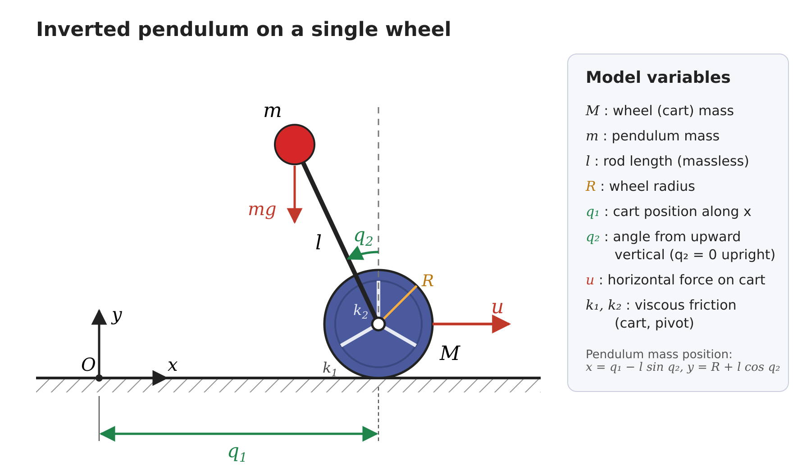


<!-- Begin Toc -->

## Table of Contents
&#8195;&#8195;[1. Model of the system](#TMP_6f79)
 
&#8195;&#8195;[2. Model linearization](#TMP_2298)
 
&#8195;&#8195;[3. Simulink Model of the system](#TMP_384f)
 
&#8195;&#8195;[4. System analysis](#TMP_5f4a)
 
&#8195;&#8195;&#8195;[Stability](#TMP_13e9)
 
&#8195;&#8195;&#8195;[Controllability and observability](#TMP_4085)
 
&#8195;&#8195;[5.Control](#TMP_0911)
 
&#8195;&#8195;&#8195;[Loop shaping with PID controller](#TMP_565c)
 
&#8195;&#8195;&#8195;[Model validation](#TMP_130c)
 
&#8195;&#8195;&#8195;[State feedback control](#TMP_7b2d)
 
&#8195;&#8195;&#8195;[State feedback controller with cart position (q\_1) as output](#TMP_4886)
 
&#8195;&#8195;&#8195;[State feedback controller with swing angle (q\_2) as output](#TMP_6a4a)
 
&#8195;&#8195;&#8195;[LQR state feedback control](#TMP_2ff7)
 
&#8195;&#8195;&#8195;[Observer based state feedback control](#TMP_8d2b)
 
&#8195;&#8195;&#8195;[States observer based-LQR State feedback with integral action](#TMP_51d0)
 
&#8195;&#8195;&#8195;[Sliding mode control](#TMP_1df1)
 
<!-- End Toc -->

<a id="TMP_6f79"></a>

## Main results
- The open-loop system is unstable: one pole at s = +3.60.
- u → q₂ has a zero at s = 0. Consequences: no proportional controller stabilizes the pendulum, the reference gain for q₂ is infinite, and integral action on q₂ is impossible. Integral action is therefore placed on q₁.
- u → q₁ has a right-half-plane zero at s = +3.12: the wheel always starts in the wrong direction (about +0.4 m before a −5 m move): the system is non-minimum phase with respect to q₁.
- The state is observable from q₁ (rank 4) but not from q₂ alone (rank 3), so the observer measures q₁.
- The nonlinear simulation model is validated: two independent implementations agree within 0.019°, and the linear model stays within 0.66° of it at 17°.
- TO DO  [one sentence: which controller gives the best trade-off, from the table in section 5.7]


## 1. Model of the system

The system has 2 degrees of freedom q1 and q2. 

Considering the (x,y) frame the position of the masses are given as 

$$
\left\lbrace \begin{array}{l}
\vec{OM} = q_1\,\vec{x} \\
\vec{Om} = \left(q_1 - l\sin q_2\right)\vec{x} + l\cos q_2\,\vec{y}
\end{array}\right.
$$ 


The velocities are:

$$
\left\lbrace \begin{array}{l}
\frac{d\vec{OM}}{dt} = \dot{q}_1\,\vec{x} \\
\frac{d\vec{Om}}{dt} = \left(\dot{q}_1 - l\,\dot{q}_2\cos q_2\right)\vec{x} - l\,\dot{q}_2\sin q_2\,\vec{y}
\end{array}\right.
$$ 

The kinetic energy of the system is given as 

$$
T = \frac{1}{2}M\,v_M^2 + \frac{1}{2}m\,v_m^2
$$

$$
T = \frac{1}{2}M\,\dot{q}_1^2 + \frac{1}{2}m\left(\left(\dot{q}_1 - l\,\dot{q}_2\cos q_2\right)^2 + \left(l\,\dot{q}_2\sin q_2\right)^2\right)
$$

$$
T = \frac{1}{2}(M+m)\,\dot{q}_1^2 + \frac{1}{2}m\left(l^2\dot{q}_2^2 - 2l\,\dot{q}_1\dot{q}_2\cos q_2\right)
$$ 

Only the pendulum contributes to the potential energy, since the wheel centre stays at constant height:

$$
V = m\,g\,l\cos q_2
$$ 

From the above energy equations, we obtain the Lagrangian

$$
\mathcal{L} = T - V = \frac{1}{2}(M+m)\,\dot{q}_1^2 + \frac{1}{2}m\left(l^2\dot{q}_2^2 - 2l\,\dot{q}_1\dot{q}_2\cos q_2\right) - m\,g\,l\cos q_2
$$ 

The system is not conservative: viscous friction acts on the wheel (coefficient k₁) and at the pivot (k₂). It is introduced through the Rayleigh dissipation function, and the generalized Lagrange equations become: 

$$
\frac{d}{dt}\left(\frac{\partial \mathcal{L}}{\partial \dot{q}_i}\right) - \frac{\partial \mathcal{L}}{\partial q_i} = Q_i
$$ 

Rayleigh dissipation function will be used to introduce the friction force proportional to velocity. 

$$
R(\dot{q}) = \frac{1}{2}\sum_{i} k_i\,\dot{q}_i^2 = \frac{1}{2}\left(k_1\dot{q}_1^2 + k_2\dot{q}_2^2\right)
$$ 

the dissipation force is given as $F_i = -\frac{\partial R}{\partial \dot{q}_i}$, for example $F_1 = -k_1\dot{q}_1$ 

Thus $Q_i = F_i + Q_i^{\mathrm{ext}}$, where $Q_i^{\mathrm{ext}}$ is the generalized external force on $q_i$ ($u$ on $q_1$, none on $q_2$) 

- Lagrange equation w.r.t. $q_1$

$$
\frac{d}{dt}\left(\frac{\partial \mathcal{L}}{\partial \dot{q}_1}\right) - \frac{\partial \mathcal{L}}{\partial q_1} = -k_1\dot{q}_1 + u
$$ 

 $\frac{\partial \mathcal{L}}{\partial \dot{q}_1} = (M+m)\,\dot{q}_1 - m\,l\,\dot{q}_2\cos q_2$;   

$$
\frac{d}{dt}\left(\frac{\partial \mathcal{L}}{\partial \dot{q}_1}\right) = (M+m)\,\ddot{q}_1 - m\,l\,\ddot{q}_2\cos q_2 + m\,l\,\dot{q}_2^2\sin q_2
$$ 

$$
\frac{\partial \mathcal{L}}{\partial q_1} = 0
$$ 

$$
\Rightarrow\; (M+m)\,\ddot{q}_1 - m\,l\,\ddot{q}_2\cos q_2 + m\,l\,\dot{q}_2^2\sin q_2 + k_1\dot{q}_1 = u
$$ 

- Lagrange equation w.r.t. $q_2$

$$
\Rightarrow\; -m\,l\,\ddot{q}_1\cos q_2 + m\,l^2\ddot{q}_2 - m\,g\,l\sin q_2 = -k_2\dot{q}_2
$$ 

The model of the system is given as 

$$
\left\lbrace \begin{array}{l}
(M+m)\,\ddot{q}_1 - m\,l\,\ddot{q}_2\cos q_2 + m\,l\,\dot{q}_2^2\sin q_2 + k_1\dot{q}_1 = u \\
-m\,l\,\ddot{q}_1\cos q_2 + m\,l^2\ddot{q}_2 - m\,g\,l\sin q_2 + k_2\dot{q}_2 = 0
\end{array}\right.
$$ 

<a id="TMP_2298"></a>

## 2. Model linearization

 

$$
q_2 \approx 0,\quad \dot{q}_2 \approx 0 \;\Rightarrow\; \dot{q}_2^2 \approx 0,\quad \dot{q}_2^2\sin q_2 \approx 0
$$ 

$$
q_2 \approx 0 \;\Rightarrow\;
\left\lbrace \begin{array}{l}
\cos q_2 \approx 1 \\
\sin q_2 \approx q_2
\end{array}\right.
$$ 

$$
\Rightarrow
\left\lbrace \begin{array}{l}
(M+m)\,\ddot{q}_1 - m\,l\,\ddot{q}_2 + k_1\dot{q}_1 = u \\
-m\,l\,\ddot{q}_1 + m\,l^2\ddot{q}_2 - m\,g\,l\,q_2 + k_2\dot{q}_2 = 0
\end{array}\right.
$$ 

$$
\Rightarrow
\left\lbrace \begin{array}{l}
\ddot{q}_1 = \frac{m\,l}{M+m}\,\ddot{q}_2 - \frac{k_1}{M+m}\,\dot{q}_1 + \frac{1}{M+m}\,u \\
\ddot{q}_2 = \frac{1}{l}\,\ddot{q}_1 - \frac{k_2}{m\,l^2}\,\dot{q}_2 + \frac{g}{l}\,q_2
\end{array}\right.
$$ 

$$
\Rightarrow
\left\lbrace \begin{array}{l}
\ddot{q}_1 = \frac{m}{M+m}\,\ddot{q}_1 - \frac{k_2}{(M+m)\,l}\,\dot{q}_2 + \frac{m\,g}{M+m}\,q_2 - \frac{k_1}{M+m}\,\dot{q}_1 + \frac{1}{M+m}\,u \\
\ddot{q}_2 = \frac{m}{M+m}\,\ddot{q}_2 - \frac{k_1}{(M+m)\,l}\,\dot{q}_1 - \frac{k_2}{m\,l^2}\,\dot{q}_2 + \frac{g}{l}\,q_2 + \frac{1}{(M+m)\,l}\,u
\end{array}\right.
$$ 

$$
\Rightarrow
\left\lbrace \begin{array}{l}
M\,\ddot{q}_1 = -k_1\dot{q}_1 - \frac{k_2}{l}\,\dot{q}_2 + m\,g\,q_2 + u \\
M\,\ddot{q}_2 = -\frac{k_1}{l}\,\dot{q}_1 - \frac{(M+m)\,k_2}{m\,l^2}\,\dot{q}_2 + \frac{(M+m)\,g}{l}\,q_2 + \frac{1}{l}\,u
\end{array}\right.
$$ 

$$
\Rightarrow
\left\lbrace \begin{array}{l}
\ddot{q}_1 = -\frac{k_1}{M}\,\dot{q}_1 - \frac{k_2}{M\,l}\,\dot{q}_2 + \frac{m\,g}{M}\,q_2 + \frac{1}{M}\,u \\
\ddot{q}_2 = -\frac{k_1}{M\,l}\,\dot{q}_1 - \frac{(M+m)\,k_2}{M\,m\,l^2}\,\dot{q}_2 + \frac{(M+m)\,g}{M\,l}\,q_2 + \frac{1}{M\,l}\,u
\end{array}\right.
$$ 

  

$$
\Rightarrow
\left\lbrace \begin{array}{l}
\dot{q}_1 = \dot{q}_1 \\
\dot{q}_2 = \dot{q}_2 \\
\ddot{q}_1 = -\frac{k_1}{M}\,\dot{q}_1 - \frac{k_2}{M\,l}\,\dot{q}_2 + \frac{m\,g}{M}\,q_2 + \frac{1}{M}\,u \\
\ddot{q}_2 = -\frac{k_1}{M\,l}\,\dot{q}_1 - \frac{(M+m)\,k_2}{M\,m\,l^2}\,\dot{q}_2 + \frac{(M+m)\,g}{M\,l}\,q_2 + \frac{1}{M\,l}\,u
\end{array}\right.
$$ 

$$
\left\lbrack \begin{array}{c} \dot{q}_1 \\ \dot{q}_2 \\ \ddot{q}_1 \\ \ddot{q}_2 \end{array}\right\rbrack
=
\left\lbrack \begin{array}{cccc}
0 & 0 & 1 & 0 \\
0 & 0 & 0 & 1 \\
0 & \frac{m\,g}{M} & -\frac{k_1}{M} & -\frac{k_2}{M\,l} \\
0 & \frac{(M+m)\,g}{M\,l} & -\frac{k_1}{M\,l} & -\frac{(M+m)\,k_2}{M\,m\,l^2}
\end{array}\right\rbrack
\left\lbrack \begin{array}{c} q_1 \\ q_2 \\ \dot{q}_1 \\ \dot{q}_2 \end{array}\right\rbrack
+
\left\lbrack \begin{array}{c} 0 \\ 0 \\ \frac{1}{M} \\ \frac{1}{M\,l} \end{array}\right\rbrack u
$$ 

This linear model is valid near the upright position. Section 3.1 measures its error against the nonlinear model: 0.066% at small angle, and at most 0.66° at 17°.

<a id="TMP_384f"></a>

## 3. Simulink Model of the system

The simulations use the following parameters:

 $M = 1.5\ \mathrm{kg}$, $m = 0.5\ \mathrm{kg}$, $g = 9.81\ \mathrm{m/s^2}$, $l = 1\ \mathrm{m}$, $k_1 = k_2 = 0.01$, 

Unless stated otherwise, the measured output is the pendulum angle, $y = q_2$.

```matlab
clear all
close all
clc
```

```matlab


run("parameters.m");


[plant_ss, plant_tf, plant_zpk] = syst_repr_generator(params, 'q2');
plant_ss.StateName = {'q_1', 'q_2', '\dot{q_1}', '\dot{q_2}'}; 
q20 = 10;
Tsim = 10;
% plant_ss
plant_tf
```

```matlabTextOutput
plant_tf = 
     0.6667 s^2 + 1.4e-17 s + 6.598e-16
  ----------------------------------------
  s^4 + 0.03333 s^3 - 13.08 s^2 - 0.0654 s
 
Continuous-time transfer function.
Model Properties
```

```matlab
dcgain(plant_tf)
```

```matlabTextOutput
ans = Inf
```

```matlab


plant_zpk
```

```matlabTextOutput
plant_zpk = 
            0.66667 s
  -----------------------------
  (s+3.631) (s-3.602) (s+0.005)
 
Continuous-time zero/pole/gain model.
Model Properties
```

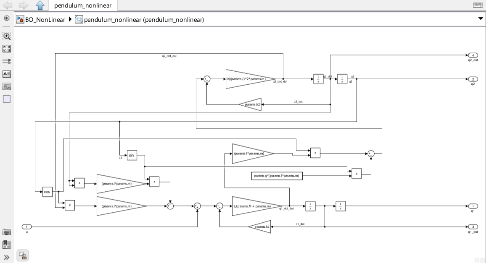

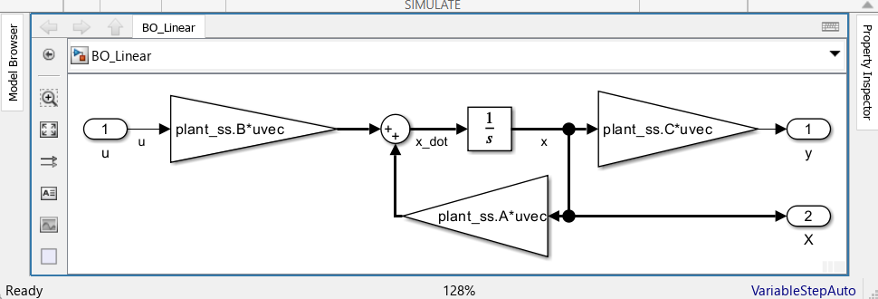

<a id="TMP_5f4a"></a>

### 3.1 Model validation
The nonlinear model is implemented in two ways. A block diagram of the Lagrange equations creates an algebraic loop, because $\ddot{q}_1$ requires $\ddot{q}_2$ and vice versa. The second implementation removes the loop by solving the mass-matrix form in a MATLAB Function block (src/pendulum_cart_nl.m)
$$
\left\lbrace \begin{array}{l}
(M+m)\,\ddot{q}_1 - m\,l\,\ddot{q}_2\cos q_2 = u - m\,l\,\dot{q}_2^2\sin q_2 - k_1\dot{q}_1 \\
-m\,l\,\ddot{q}_1\cos q_2 + m\,l^2\ddot{q}_2 = m\,g\,l\sin q_2 - k_2\dot{q}_2
\end{array}\right.
$$ 

$$
\left\lbrack \begin{array}{c} \ddot{q}_1 \\ \ddot{q}_2 \end{array}\right\rbrack
=
\left\lbrack \begin{array}{cc} M+m & -m\,l\cos q_2 \\ -m\,l\cos q_2 & m\,l^2 \end{array}\right\rbrack^{-1}
\left\lbrack \begin{array}{c} u - m\,l\,\dot{q}_2^2\sin q_2 - k_1\dot{q}_1 \\ m\,g\,l\sin q_2 - k_2\dot{q}_2 \end{array}\right\rbrack
$$ 

<a id="TMP_130c"></a>

Three checks are made: an open-loop fall test, a small-angle comparison with the linear model, and a comparison of the three plant models in closed loop with the PID of section 5.1.

- **Open\-loop fall test**

```matlab
run parameters.m
x0 = [0; deg2rad(0.5); 0; 0];
[t, x] = ode45(@(t,x) pendulum_cart_nl(x, 0, params), [0 50], x0);
clf("reset")
figure
plot(t, rad2deg(x(:,2))); grid on; xlabel('t [s]'); ylabel('q_2 [deg]')
```

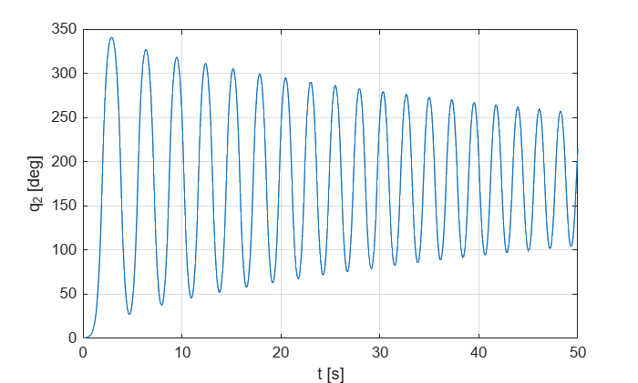

*Figure 1: Open-loop fall test of the nonlinear model, q₂(0) = 0.5°, u = 0.*

Released at 0.5° with u = 0, the pendulum stays near the top for about 1 s, then falls and oscillates around the hanging position (±180°) with an amplitude that slowly decreases because of the pivot friction k₂. The model reproduces the expected physical behaviour.

- **linear vs nonlinear at small angle**

```matlab


plant = syst_repr_generator(params, 'q2');
t  = linspace(0, 0.8, 801)';
[~, ~, xl] = initial(plant, x0, t);
[~, xn]    = ode45(@(t,x) pendulum_cart_nl(x, 0, params), t, x0);
clf("reset")
figure
plot(t, rad2deg(xl(:,2)), t, rad2deg(xn(:,2)), '--'); 
legend('linear', 'nonlinear'); xlabel('t [s]'); ylabel('q_2 [deg]')
```

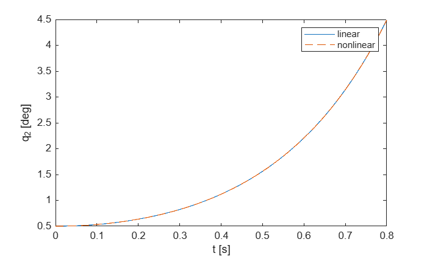

*Figure 2: Linear vs nonlinear model, open loop, q₂(0) = 0.5°.*

```matlab
relErr = abs(xn(end,2) - xl(end,2)) / abs(xl(end,2))
```

```matlabTextOutput
relErr = 6.6129e-04
```

Over the first 0.8 s, the linear and nonlinear responses overlap: the relative error at t = 0.8 s is 0.066%.

- **Linear model (variant 1) vs block model (variant 2) vs MATLAB Function (variant 3)**

```matlab
run parameters.m
plant_ss = syst_repr_generator(params, 'q2');
input_select = plant_ss.C(1:2);
Tsim = 10;  Ts = 1e-4;  q2_f = deg2rad(-10);
params.IC = [0, deg2rad(1), 0, 0];
clf("reset")
figure; hold on; grid on
for model = 1:3                       % 1 linear, 2 blocks, 3 MATLAB Function
    out = sim("mdl_with_PID");
    X = states_from_log(x);
    Xs{model} = X;
    plot(x.Time, rad2deg(X(:,2)), 'DisplayName', "model " + model)


end
```

```matlabTextOutput
Warning: Model 'mdl_with_PID' contains 1 algebraic loops. 
Suggested Actions:
    • Highlight and view information about the algebraic loops in the model using the Simulink.BlockDiagram.getAlgebraicLoops function. - Open
    • Suppress this diagnostic by setting the 'Algebraic Loop' diagnostic parameter to 'none'. - Fix


```

```matlab
maxDiff_2vs3 = max(abs(rad2deg(Xs{2}(:,2) - Xs{3}(:,2))))   
```

```matlabTextOutput
maxDiff_2vs3 = 0.0192
```

```matlab
maxDiff_1vs3 = max(abs(rad2deg(Xs{1}(:,2) - Xs{3}(:,2))))   
```

```matlabTextOutput
maxDiff_1vs3 = 0.6567
```

```matlab
legend; xlabel('t [s]'); ylabel('q_2 [deg]')
```

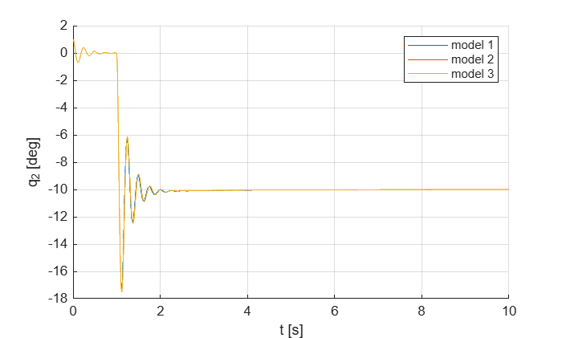

*Figure 3: PID on q₂ with the three plant models (linear, block diagram, MATLAB Function).*

The nonlinear model was implemented twice: as a Simulink block diagram and as a MATLAB Function solving the mass\-matrix form of the Lagrange equations. Under the same PID scenario (q₂₀ = 1°, step to −10°), the two implementations differ by at most 0.019° over 10 s, which confirms both. The linear model differs from them by at most 0.66°, about 4% of the 17° peak, consistent with the small\-angle approximation at that amplitude.

## 4. System analysis
<a id="TMP_1ab7"></a>
 

<a id="TMP_13e9"></a>

### 4.1 Stability

```matlab
[plant_ss, plant_tf, plant_zpk] = syst_repr_generator(params, 'q2');


poles_syst = pole(plant_ss)
```

```matlabTextOutput
poles_syst = 4x1


-3.6308    
3.6025     
-0.0050    
0          


```

```matlab
zeros_syst = zero(plant_ss)
```

```matlabTextOutput
zeros_syst = 2x1
1.0e+-16
0.4043    
0         


```

```matlab
clf("reset")
figure
pzmap(plant_ss)
```

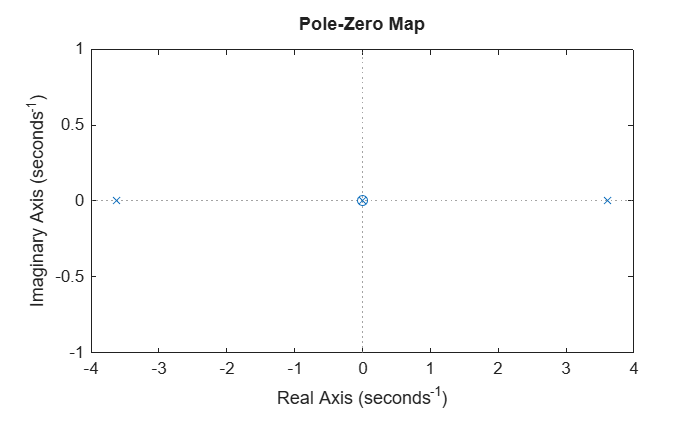

*Figure 4: Open-loop poles and zeros, u → q₂.*

```matlab
[plant_ss, plant_tf, plant_zpk] = syst_repr_generator(params, 'q1');
zeros_syst = zero(plant_ss)
```

```matlabTextOutput
zeros_syst = 2x1


3.1221     
-3.1421    


```

The open-loop system is unstable: it has a real pole at s = +3.60, so a small tilt grows like e^(3.6 t) and the pendulum falls in about one second. The pole at s = 0 is the free wheel position, and the pole at s = −0.005 is the slow decay of the wheel speed through friction.

The transfer function from u to $q_2$ has a zero at the origin (s = 0). It cancels the open\-loop pole at the origin, which is why the reduced transfer function has 3 poles and 1 zero. From u to the cart position $q_1$ there is a right\-half\-plane zero at s=3.1221, so the system is non\-minimum phase with respect to q1.

<a id="TMP_2110"></a>
```matlab
[plant_ss, plant_tf, plant_zpk] = syst_repr_generator(params, 'q2');


clf("reset")
figure 
rlocus(plant_ss)
```

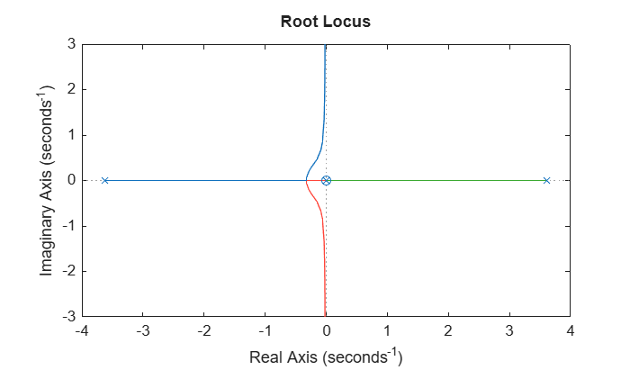

*Figure 5: Root locus of u → q₂ under proportional feedback.*

$$
OL(s) = \frac{N(s)}{D(s)},\qquad \text{with } C(s) = P:\quad CL(s) = \frac{P\,N(s)}{D(s) + P\,N(s)}
$$ 

A proportional controller alone cannot stabilize the system. The transfer function has 3 poles and 1 zero, located at the origin. As the gain increases, the unstable pole (s = +3.60) moves along the real axis towards that zero, so it never enters the left half\-plane. Therefore no finite P gain can stabilize the system.

<a id="TMP_44e2"></a>
<a id="TMP_4085"></a>

### 4.2 Controllability and observability

```matlab
run parameters.m
[plant_ss_q1] = syst_repr_generator(params,'q1');
[plant_ss_q2] = syst_repr_generator(params,'q2');
plant_ss = plant_ss_q1;
Qc = ctrb(plant_ss);


rc = rank(Qc)
```

```matlabTextOutput
rc = 4
```

```matlab
ro_q1 = rank(obsv(plant_ss_q1))
```

```matlabTextOutput
ro_q1 = 4
```

```matlab
ro_q2 = rank(obsv(plant_ss_q2))
```

```matlabTextOutput
ro_q2 = 3
```

The controllability matrix has rank 4 = n: the single input u can drive every state. The observability matrix has rank 4 with y = q₁ but only 3 with y = q₂: the wheel position cannot be reconstructed from the angle, because the angle dynamics do not depend on where the wheel is. Every observer in this report therefore measures q₁.

```matlab
plant_ss_diag = diagonalize(plant_ss)
```

```matlabTextOutput
plant_ss_diag = 
  A = 
           x1      x2      x3      x4
   x1       0       0       0       0
   x2       0  -3.631       0       0
   x3       0       0   3.602       0
   x4       0       0       0  -0.005
 
  B = 
           u1
   x1     100
   x2  0.3583
   x3  0.3547
   x4    -100
 
  C = 
             x1        x2        x3        x4
   y1         1  -0.06448   0.06479         1
 
  D = 
       u1
   y1   0
 
Continuous-time state-space model.
Model Properties
```

In modal form, the eigenvalues are distinct and every entry of B is non-zero, so the input reaches every mode. This confirms controllability.

<a id="TMP_0911"></a>

## 5. Control

All controllers are designed on the linear model and simulated on the nonlinear model (MATLAB Function, model = 3) unless stated otherwise. Section 5.7 compares them on the same scenario.
<a id="TMP_565c"></a>

### 5.1 PID controller (loop shaping)
1. **u to q2  (q2 as output)**

The PID is tuned on the loop u → q₂ with Control System Designer. Gains: $Kp = 830.80$ , $Ki = 430.55$ , $Kd = 14.79$; phase margin $0.481 \deg$ at a crossover of $2.99 rad/s$.

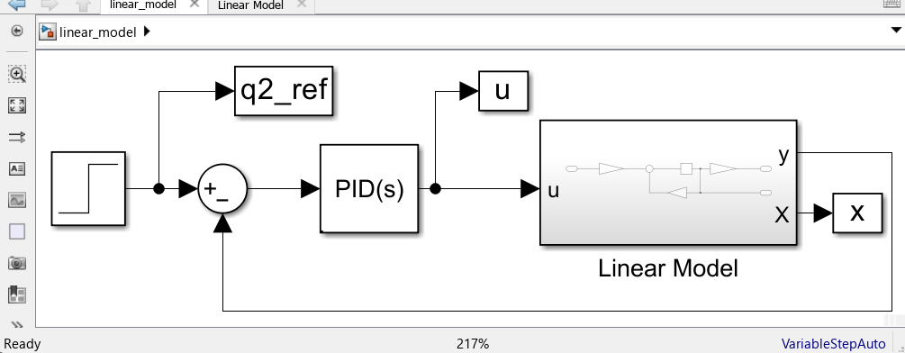

The simulation starts at q₂(0) = 1° and commands a step to −10° at t = 1 s.


The PID is simulated on the validated nonlinear model (MATLAB Function).

```matlab


Tsim = 10;
Ts = 1e-4;
q2_f = deg2rad(-10);
params.IC = [0,deg2rad(1),0,0];
model = 3; % 1 : linear model,   2: non linear model  , 3: Matlab fct non linear model
[plant_ss] = syst_repr_generator(params,'q2');
input_select = plant_ss.C(1:2);
sim("models/mdl_with_PID.slx");
refs = {'q1_ref', 'q2_ref'};


X = states_from_log(x);              
animate_pendulum_cart(x.Time, X(:,1), X(:,2), u.Data, params, 'fps', 100, ...
    string(refs(input_select==1)), ref.Data*input_select', 'model', model);
```

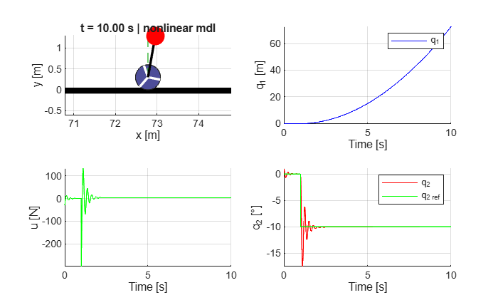

*Figure 6: PID on q₂, nonlinear model (MATLAB Function), step to −10°.*

The PID holds the pendulum at the commanded −10°. Holding $q_2$  constant ( $\dot{q}_2 = 0$ and $\ddot{q}_2 = 0$ ) at \-10° needs a constant acceleration of the cart, $\ddot{q}_1 = a = -g\tan q_2 \approx 1.73\ \mathrm{m/s^2}$. So the cart position $q_1$ grows like a parabola  ( $\approx 70\ \mathrm{m}$ in $9\ \mathrm{s}$ ) and u settles at  $(M+m)\,a \approx 3.5\ \mathrm{N}$ 

- **u to q1 (q1 as output)**

```matlab
Tsim = 10;
Ts = 1e-4;
q2_f = deg2rad(-10);
params.IC = [0,deg2rad(1),0,0];
model = 1; % 1 : linear model,   2: non linear model  , 3: Matlab fct non linear model
[plant_ss] = syst_repr_generator(params,'q1');
input_select = plant_ss.C(1:2);
sim("models/mdl_with_PID.slx");
refs = {'q1_ref', 'q2_ref'};


X = states_from_log(x);              
animate_pendulum_cart(x.Time, X(:,1), X(:,2), u.Data, params, 'fps', 100, ...
    string(refs(input_select==1)), ref.Data*input_select', 'model', model);
```

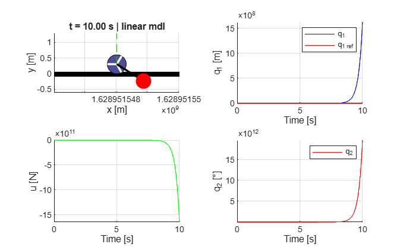

*Figure 7: PID with q₁ as output, linear model: the loop diverges.*

With q₁ as the only measurement, the PID cannot stabilize the system and every state diverges. The reason is structural: from u to q₁ the right-half-plane zero (+3.12) lies below the unstable pole (+3.60), with no zero between that pole and infinity. Such a plant can only be stabilized by an unstable controller (parity interlacing property), so no classical PID on q₁ alone can do it. Balancing requires feedback on the angle, which is what the state-feedback controllers below provide.

<a id="TMP_7b2d"></a>

### 5.2 Pole placement state feedback

This control law is expressed as $u = -Kx + k_{\mathrm{scale}}\,y_{\mathrm{ref}}$ 

The state feedback u = −Kx uses all four states, whatever the output. The output only matters for reference tracking: the gain k_scale = 1/G_cl(0) makes one chosen output follow its reference in steady state. Two choices are studied: y = q₁ and y = q₂.

<a id="TMP_4886"></a>
#### 5.2.1 State feedback controller with cart position (q\_1) as output 

By default we will set $k_{\mathrm{scale}} = 1$ 

```matlab
[plant_ss]  = syst_repr_generator(params,'q1');
poles_des = [-3, -3, -3, -3];
rank(plant_ss.B);
K = acker(plant_ss.A,plant_ss.B, poles_des);
Tsim = 20;
Ts = 1e-4;
q2_f = deg2rad(10);
params.IC = [0,deg2rad(20),0,0];
model = 3; % 1 : linear model       2: non linear model    3: Matlab fct non linear model
k_scale = 1;
input_select = plant_ss.C(1:2);
refs = {'q1_ref', 'q2_ref'};
sim('models/mdl_with_State_Feedback.slx');
X = states_from_log(x);              
animate_pendulum_cart(x.Time, X(:,1), X(:,2), u.Data, params, 'fps', 100, ...
    string(refs(input_select==1)), ref.Data*input_select', 'model', model);
```

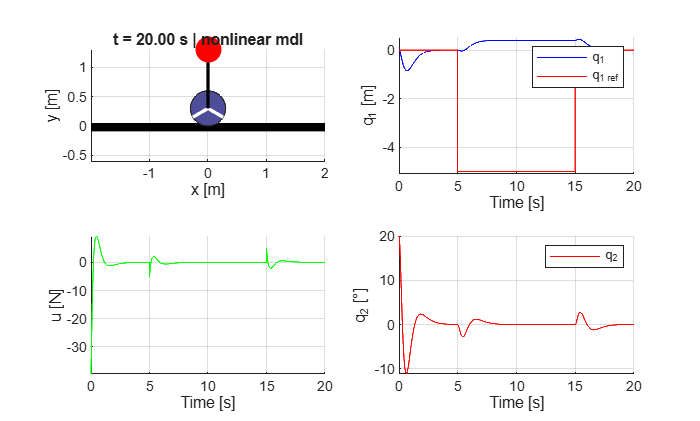

*Figure 8: Pole placement (poles at −3), k_scale = 1, nonlinear model.*

With k_scale = 1 the loop is stable (four poles at −3), but the closed-loop DC gain from reference to q₁ is −6.54/81 ≈ −0.081. The wheel therefore settles at +0.40 m instead of −5 m: the wrong size, and the wrong sign.

To illustrate the compensator effect, let's consider a simple first order system with a static gain of 0.5. The step plot shows a response settling at 0.5 instead of 1, the reference. With the compensator, the output is scaled to catch the reference. The same principle is used in state feedback controller.

```matlab
s = zpk('s');
toy_system = 2/(4 + s)
```

```matlabTextOutput
toy_system = 
    2
  -----
  (s+4)
 
Continuous-time zero/pole/gain model.
Model Properties
```

```matlab
clf(gcf)
figure
step(toy_system)
```

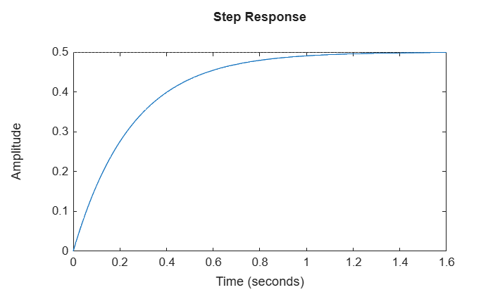

*Figure 9: Step response of the example system 2/(s + 4).*

```matlab
figure
clf(gcf)
dcg = dcgain(toy_system)
```

```matlabTextOutput
dcg = 0.5000
```

```matlab
compensator = 1/dcg
```

```matlabTextOutput
compensator = 2
```

```matlab
step(compensator*toy_system)
```

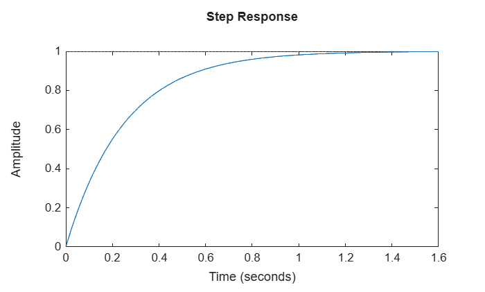

*Figure 10: Same system with the static gain compensated.*

By default we will set $k_{\mathrm{scale}} = \frac{1}{G_{cl}(0)}$, the inverse of the closed-loop DC gain 

```matlab
[plant_ss]  = syst_repr_generator(params,'q1');
poles_des = [-3, -3, -3, -3];
rank(plant_ss.B);
K = acker(plant_ss.A,plant_ss.B, poles_des);
Tsim = 20;
Ts = 1e-4;
q2_f = deg2rad(20);
params.IC = [0,deg2rad(20),0,0];
model = 3; % 1 : linear model       2: non linear model    3: Matlab fct non linear model


A_cl = plant_ss.A - plant_ss.B*K;
B_cl = plant_ss.B;
closed_loop_ss =  ss(A_cl, B_cl, plant_ss.C, 0);
[b,a] = ss2tf(A_cl,B_cl, plant_ss.C,0);
closed_loop_tf = tf(b,a)
```

```matlabTextOutput
closed_loop_tf = 
    0.6667 s^2 + 0.01333 s - 6.54
  ----------------------------------
  s^4 + 12 s^3 + 54 s^2 + 108 s + 81
 
Continuous-time transfer function.
Model Properties
```

```matlab
dcg = dcgain(closed_loop_ss);
k_scale = 1/dcg;
input_select = plant_ss.C(1:2);
refs = {'q1_ref', 'q2_ref'};


sim('models/mdl_with_State_Feedback.slx');
clf("reset")
figure;
X = states_from_log(x);              
animate_pendulum_cart(x.Time, X(:,1), X(:,2), u.Data, params, 'fps', 100, ...
    string(refs(input_select==1)), ref.Data*input_select', 'model', model);
```

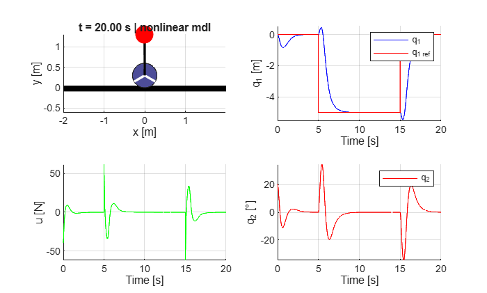

*Figure 11: Pole placement (poles at −3), $k_{scale} = 1/G_{cl}(0)$, nonlinear model, wheel step to −5 m at t = 5 s.*

With $k_{scale} = 1/G_{cl}(0) ≈ −12.4$, the wheel reaches −5 m and then 0 m. Each step starts with a move in the wrong direction (about +0.4 m), the signature of the right-half-plane zero at +3.12. 
 Settling time $2.75 s$; the pendulum tilts up to $34.79°$ and the force peaks at $61.92 N$ , because four poles at −3 make an aggressive design.


<a id="TMP_6a4a"></a>
#### 5.2.2 State feedback controller with swing angle (q\_2) as output 

With y = q₂ the reference gain cannot be computed. State feedback moves the poles but never the zeros, and u → q₂ keeps its zero at s = 0: the constant term of the numerator is $b_0 \approx -1.9\cdot 10^{-16} \approx 0$. The closed-loop DC gain is therefore 0 and $k_{\mathrm{scale}} = 1/0$ is infinite. No constant angle can be held: a tilted pendulum needs a constant acceleration of the wheel, so it has no steady state.

```matlab
[plant_ss]  = syst_repr_generator(params,'q2');
poles_des = [-3, -3, -3, -3];
rank(plant_ss.B);
K = acker(plant_ss.A,plant_ss.B, poles_des);
Tsim = 20;
Ts = 1e-4;
q2_f = deg2rad(20);
params.IC = [0,deg2rad(20),0,0];
model = 3; % 1 : linear model       2: non linear model    3: Matlab fct non linear model


A_cl = plant_ss.A - plant_ss.B*K;
B_cl = plant_ss.B;
closed_loop_ss =  ss(A_cl, B_cl, plant_ss.C, 0);
[b,a] = ss2tf(A_cl,B_cl, plant_ss.C,0);
closed_loop_tf = tf(b,a)
```

```matlabTextOutput
closed_loop_tf = 
  0.6667 s^2 + 1.668e-15 s - 1.866e-16
  ------------------------------------
   s^4 + 12 s^3 + 54 s^2 + 108 s + 81
 
Continuous-time transfer function.
Model Properties
```

```matlab
dcg = dcgain(closed_loop_ss)
```

```matlabTextOutput
dcg = 0
```

```matlab
k_scale = 1/dcg
```

```matlabTextOutput
k_scale = Inf
```

<a id="TMP_2ff7"></a>

### 5.3 LQR state feedback

LQR chooses K by minimizing $J=\int (x^T Q x + R\,u^2)\,dt$ instead of placing the poles by hand. With Q = I and R = 0.1, deviations of the states cost more than the force, but the force is not free, which limits the peaks seen with pole placement.

```matlab
[plant_ss]  = syst_repr_generator(params,'q1');
Q = eye(4);       
R  =0.1;
K = lqr(plant_ss.A, plant_ss.B, Q, R);
A_cl = plant_ss.A - plant_ss.B*K;
B_cl = plant_ss.B;
closed_loop =  ss(A_cl, B_cl, plant_ss.C, 0);


dcg = dcgain(closed_loop);
k_scale = 1/dcg;
Tsim = 20;
Ts = 1e-4;
q2_f = deg2rad(10);
params.IC = [0,deg2rad(10),0,0];
model = 3; % 1 : linear model       2: non linear model    3: Matlab fct non linear model


input_select = plant_ss.C(1:2);
sim('models/mdl_with_State_Feedback.slx');
refs = {'q1_ref', 'q2_ref'};


X = states_from_log(x);              
animate_pendulum_cart(x.Time, X(:,1), X(:,2), u.Data, params, 'fps', 100, ...
    string(refs(input_select==1)), ref.Data*input_select', 'model', model);
```

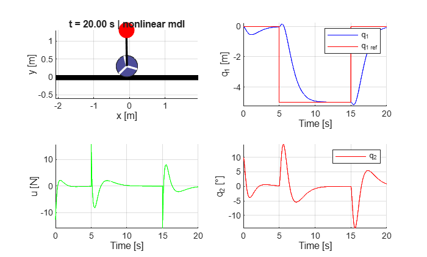

*Figure 13: LQR (Q = I, R = 0.1), nonlinear model, wheel step to −5 m at t = 5 s.*

Compared with pole placement, LQR keeps the force within 15.75 N (instead of 61.92 N) and the pendulum within 14.42° (instead of 34.79°), at the cost of a slower move: settling time 4.77 s instead of 2.75 s.

<a id="TMP_6cfa"></a>
<a id="TMP_8d2b"></a>

### 5.4 Observer-based state feedback

In practice only q₁ is measured (section 4: the state is observable from q₁, not from q₂). A Luenberger observer reconstructs the full state from u and y = q₁:

 $\dot{x}_o = A\,x_o + B\,u + L\,(y - y_o)$  ; $y_o = C\,x_o$ and $y = C\,x$ $\Rightarrow$ $\dot{x}_o = (A - LC)\,x_o + B\,u + L\,y$ 

where $y_o$ is the estimated output. The estimation error $e = x - x_o$ obeys $\dot{e} = (A - L\,C)\,e$, so its decay is set by the eigenvalues of A − LC. They are placed at −15, −16, −17 and −18, about 4 to 12 times faster than the controller poles (−1.2 to −4), so the estimate converges before it can disturb the control. The observer starts from $x_o(0) = 0$ while the pendulum starts at 20°.

> TO DO (model): set the Observer integrator initial condition to params.IC_obs, add params.IC_obs = [0 0 0 0] to parameters.m, log the estimate xo, and add the estimation-error plot after the simulation:
> `Xo = states_from_log(xo); figure; plot(x.Time, rad2deg(X(:,2) - Xo(:,2))); grid on; xlabel('t [s]'); ylabel('q_2 - q_2 estimate [deg]')`

```matlab


[plant_ss]  = syst_repr_generator(params,'q1');
poles_des = [-4, -3, -2.5, -1.2];
rank(plant_ss.B);
K = acker(plant_ss.A,plant_ss.B, poles_des);
Tsim = 20;
Ts = 1e-4;
q2_f = deg2rad(20);
params.IC = [0,deg2rad(20),0,0];
A_cl = plant_ss.A - plant_ss.B*K;
B_cl = plant_ss.B;
closed_loop =  ss(A_cl, B_cl, plant_ss.C, 0);
obsv_poles = [-15, -16, -17, -18];
L = place(plant_ss.A', plant_ss.C', obsv_poles)';
dcg = dcgain(closed_loop);
k_scale = 1/dcg;
input_select = plant_ss.C(1:2);
refs = {'q1_ref', 'q2_ref'};
model = 3;  % 1 : linear model       2: non linear model    3: Matlab fct non linear model
sim('models/mdl_with_State_Feedback_and_observer.slx');


X = states_from_log(x);              
animate_pendulum_cart(x.Time, X(:,1), X(:,2), u.Data, params, 'fps', 100, ...
    string(refs(input_select==1)), ref.Data*input_select', 'model', model);
```

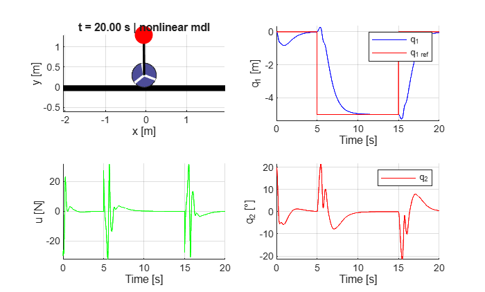

*Figure 14: Pole placement with Luenberger observer, nonlinear model.*

The estimation error on q₂ falls below 0.1° within [..] s, and the closed loop then behaves like full-state feedback: settling time [..] s, peak force [..] N.

<a id="TMP_51d0"></a>

### 5.5 Integral action (observer-based LQR)
- **u to q2 (q2 as output)**

Integral action removes steady-state errors by adding the state $z=\int (r-y)\,dt$ to the feedback. It is first tried on the pendulum angle, as a counter-example, then applied to the wheel position.

```matlab
% Augmented system (integral action on q2)
[plant_ss]  = syst_repr_generator(params,'q2');
P = [plant_ss.A, zeros(4,1); -plant_ss.C, 0]; % -C_q2
Rin = [plant_ss.B; 0];
Q = 2*eye(5);
R = 2.5;
K_aug = lqr(P, Rin, Q, R);
P_cl = P - Rin*K_aug;
R_cl = Rin ;
rank(ctrb(P, Rin)) 
```

```matlabTextOutput
ans = 4
```

```matlab
ss_cl =  ss(P_cl, R_cl, [plant_ss.C 0], 0);
pole(ss_cl)
```

```matlabTextOutput
ans = 5x1 complex


-3.9379 + 0.0000i    
-3.3400 + 0.0000i    
-0.5242 + 0.4122i    
-0.5242 - 0.4122i    
-0.0000 + 0.0000i    


```

```matlab


Tsim = 20;
Ts = 1e-4;
params.IC = [0,deg2rad(1),0,0];
model = 3; % 1: linear model       2: non linear model    3: Matlab fct non linear model
input_select = [0,1]; 
q2_f = deg2rad(2);
refs = {"q1_ref", "q2_ref"};
sim('models/mdl_with_State_Feedback_integral.slx');


X = states_from_log(x);              
animate_pendulum_cart(x.Time, X(:,1), X(:,2), u.Data, params, 'fps', 100, ...
    string(refs(input_select==1)), ref.Data*input_select', 'model', model);
```

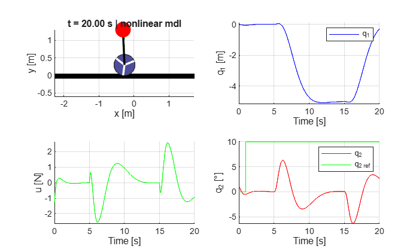

*Figure 15: LQR with integral action on q₂ (counter-example), nonlinear model.*

The plant from u to q₂ has a zero at s = 0. In the augmented system, this zero cancels the pole of the integrator, so the augmented pair (P, Rin) is not controllable (rank 4 instead of 5). LQR can only place the four controllable poles; the uncontrollable mode remains at s = 0 (the −0.0000 pole). As a result, the controller stabilizes the pendulum but cannot make q₂ track the reference: q₂ returns to 0 while the cart drifts at constant speed and the integrator state grows without bound.

Physically, integral action requires a resting state where the output equals its reference, and a controllable augmented system. Neither holds here: holding q₂ ≠ 0 requires a constant cart acceleration, so no resting state exists, and the force acts on the wheel, never directly on the pendulum mass. Integral action is therefore applied to the cart position q₁ instead, where both conditions are met.

- **u to q1 (q1 as output)**

With y = q₁ the augmented system is controllable (rank 5) and LQR places all five poles in the left half-plane. A Luenberger observer provides the unmeasured states.

```matlab


plant_ss = syst_repr_generator(params, 'q1');
P   = [plant_ss.A, zeros(4,1); -plant_ss.C, 0];
Rin = [plant_ss.B; 0];
rank(ctrb(P, Rin))            % must be 5 (it is only 4 with q2)
```

```matlabTextOutput
ans = 5
```

```matlab
Q = 10*eye(5);
R = 2.5;
K_aug = lqr(P, Rin, Q, R);
pole(ss(P - Rin*K_aug, Rin, [plant_ss.C 0], 0))   % all strictly negative
```

```matlabTextOutput
ans = 5x1 complex


-4.4139 + 0.0000i    
-3.0403 + 0.0000i    
-0.9866 + 0.0000i    
-0.7058 + 0.6999i    
-0.7058 - 0.6999i    


```

```matlab
obsv_poles = [-15, -16, -17, -18];
L = place(plant_ss.A', plant_ss.C', obsv_poles)';
Tsim = 20;
Ts = 1e-4;
params.IC = [0,deg2rad(1),0,0];
model = 3; % 1: linear model       2: non linear model    3: Matlab fct non linear model
input_select = plant_ss.C(1:2);
q2_f = deg2rad(10);
refs = {"q1_ref", "q2_ref"};
sim('models/mdl_with_State_Feedback_integral_and_observer.slx')


X = states_from_log(x);              
animate_pendulum_cart(x.Time, X(:,1), X(:,2), u.Data, params, 'fps', 100, ...
    string(refs(input_select==1)), ref.Data*input_select', 'model', model);
```

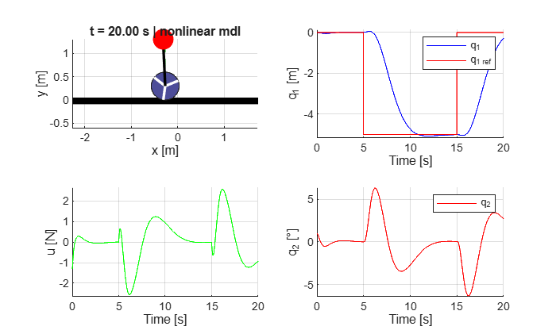

*Figure 16: LQR with integral action on q₁ and observer, nonlinear model.*

The wheel reaches each position without steady-state error, and the motion is the gentlest of the report: force within ±[..] N, pendulum within ±[..]°. The price is speed: settling time [..] s.

<a id="TMP_1df1"></a>

### 5.6 Sliding mode control

Sliding mode control is a robust control strategy that aims to drag the system dynamic to a sliding surface $S(x) = F\,x - r$. The $r$ term is added to follow a reference $y_{\mathrm{ref}}$. 

The adapted reference r is determined as follows: 

On sliding surface $S(x_\infty) = 0$ 

$$
\left\lbrack \begin{array}{c} \dot{x}_\infty \\ S(x_\infty) \end{array}\right\rbrack
=
\left\lbrack \begin{array}{cc} A & B \\ F & 0 \end{array}\right\rbrack
\left\lbrack \begin{array}{c} x_\infty \\ u_\infty \end{array}\right\rbrack
+
\left\lbrack \begin{array}{c} 0_{n\times 1} \\ -r \end{array}\right\rbrack
=
\left\lbrack \begin{array}{c} 0_{n\times 1} \\ 0 \end{array}\right\rbrack
$$ 

Let $M = \left\lbrack \begin{array}{cc} A & B \\ F & 0 \end{array}\right\rbrack$ 

$$
\left\lbrack \begin{array}{c} x_\infty \\ u_\infty \end{array}\right\rbrack
= r\,M^{-1}\left\lbrack \begin{array}{c} 0_{n\times 1} \\ 1 \end{array}\right\rbrack
= r\left\lbrack \begin{array}{c} x_t \\ u_t \end{array}\right\rbrack
$$ 

$$
y_{\mathrm{ref}} = y_\infty = C\,x_\infty + D\,u_\infty = (C\,x_t + D\,u_t)\,r = \alpha\,r \;\Longrightarrow\; r = \frac{y_{\mathrm{ref}}}{\alpha}
$$ 

A generalized Ackermann pole placement method is used to calculate $F$, with a resulting Hurwitz characteristic polynomial 

 $\gamma(s) = (s + p)^{\,n-k}$    with $n$, the order of the system and $k$, the relative degree that can be chosen freely as long as the condition $k<n$ is met. $p$ is the only desired pole to choose. 

$$
F = e_n\,Q^{-1}\,\gamma(A)
$$ 

where $Q = \left\lbrack \begin{array}{cccc} B & AB & \cdots & A^{n-1}B \end{array}\right\rbrack$ is the controllability matrix and $e_n = \left\lbrack \begin{array}{cc} 0_{1\times(n-1)} & 1 \end{array}\right\rbrack$ 

The control law $u$ is given as 

$$
u = -\frac{F\,A^{k}\,x + f(\xi)}{F\,A^{k-1}B}
$$ 

 $f(\xi)$ is the discontinuous part of the controller chosen here as $f(\xi) = k_0\tanh\left(\frac{S(x)}{\phi}\right)$. 

 $\phi$ defines the width of the boundary layer around the sliding surface.  

The design follows Hernández, Castaños and Fridman (2014), see References.

```matlab
run parameters.m
[plant_ss]  = syst_repr_generator(params,'q1');
Qc = ctrb(plant_ss.A,plant_ss.B);
e = [zeros(1,3) 1];
p = 3;
gamma = (plant_ss.A + p*eye(4))^3;
F = e*inv(Qc)*gamma; 
k0 = 20;
phi = 0.5;
q1_ref = 5; 
params.IC = [0,deg2rad(10),0,0];
q2_f = deg2rad(2);
M = [plant_ss.A, plant_ss.B; F, 0];
x_u_inf = M[zeros(4,1); 1];
alpha = plant_ss.C*x_u_inf(1:end-1);
r = q1_ref/alpha; 
input_select = plant_ss.C(1:2);
Tsim = 20;
Ts=1e-4;
model = 3; % 1 : linear model       2: non linear model    3: Matlab fct non linear model
sim('models/mdl_with_SMC.slx');
refs = {'q1_ref', 'q2_ref'};


X = states_from_log(x);              
animate_pendulum_cart(x.Time, X(:,1), X(:,2), u.Data, params, 'fps', 100, ...
    string(refs(input_select==1)), ref.Data*input_select', 'model', model);
```

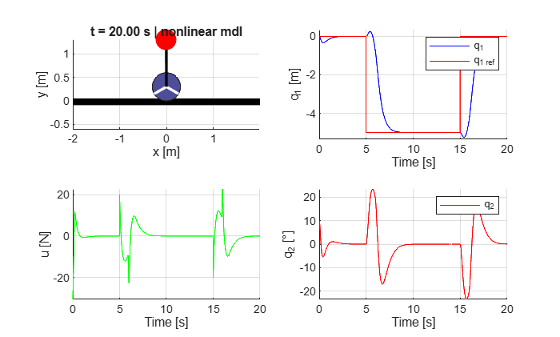

*Figure 17: Sliding mode control (p = 3, k₀ = 20), nonlinear model.*

With p = 3 and k₀ = 20, the wheel reaches −5 m in about [..] s. The tanh boundary layer (φ = 0.5) keeps the force smooth: no chattering is visible. Peak force [..] N, peak angle [..]°.

```matlab
run parameters.m
[plant_ss]  = syst_repr_generator(params,'q1');
Qc = ctrb(plant_ss.A,plant_ss.B);
e = [zeros(1,3) 1];
p = 5;
gamma = (plant_ss.A + p*eye(4))^3;
F = e*inv(Qc)*gamma; 
k0 = 50;
phi = 0.5;
q1_ref = 5; 
params.IC = [0,deg2rad(10),0,0];
q2_f = deg2rad(2);
M = [plant_ss.A, plant_ss.B; F, 0];
x_u_inf = M[zeros(4,1); 1];
alpha = plant_ss.C*x_u_inf(1:end-1);
r = q1_ref/alpha; 
input_select = plant_ss.C(1:2);
Tsim = 20;
Ts=1e-4;
model = 3; % 1 : linear model       2: non linear model    3: Matlab fct non linear model
sim('models/mdl_with_SMC.slx');
refs = {'q1_ref', 'q2_ref'};
X = states_from_log(x);              
animate_pendulum_cart(x.Time, X(:,1), X(:,2), u.Data, params, 'fps', 100, ...
    string(refs(input_select==1)), ref.Data*input_select', 'model', model);
```

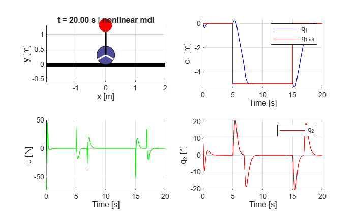

*Figure 18: Sliding mode control (p = 5, k₀ = 50), nonlinear model.*

Moving the sliding-surface poles to −5 and raising the switching gain to 50 makes the tracking faster ([..] s) but costs a much larger force (peaks of [..] N). The two runs show the main trade-off of the design: p sets the speed, and k₀ sets the robustness margin and the force.

<a id="TMP_71ff"></a>

### 5.7 Comparison

All controllers are compared on the same scenario: nonlinear model, initial angle 10°, wheel step from 0 to −5 m at t = 5 s. The metrics are measured on the step: 2% settling time, initial wrong-way motion (a consequence of the zero at +3.12), largest pendulum angle and largest force.

> TO DO: rerun each compared controller with params.IC = [0, deg2rad(10), 0, 0], compute the metrics with control_metrics, and paste the table here.

| Controller | Settling time (2%) [s] | Initial undershoot [%] | Max \|q₂\| [°] | Max \|u\| [N] |
|---|---|---|---|---|
| Pole placement + observer | [..] | [..] | [..] | [..] |
| LQR | [..] | [..] | [..] | [..] |
| LQR + integral (q₁) + observer | [..] | [..] | [..] | [..] |
| SMC (p = 3, k₀ = 20) | [..] | [..] | [..] | [..] |
| SMC (p = 5, k₀ = 50) | [..] | [..] | [..] | [..] |

[Fastest controller] settles in [..] s but needs [..] N. [Gentlest controller] keeps the force below [..] N and the angle below [..]° but takes [..] s. Every controller shows the same wrong-way start of about [..]%: it comes from the plant zero, so no controller can remove it. For a real Segway, where motor force is limited, [your choice] is the best trade-off because [..].

## 6. Conclusion

The single-wheel inverted pendulum was modelled with the Lagrange equations, linearized around the upright position, and simulated with two independent nonlinear implementations that agree within 0.019°. The analysis showed that the plant zeros shape everything that follows. The zero at s = 0 from u to q₂ prevents proportional control, reference scaling and integral action on the angle. The right-half-plane zero at +3.12 from u to q₁ forces a wrong-way start of every move and rules out a PID on the wheel position alone. With state feedback, an observer and integral action on q₁, the wheel tracks its reference without steady-state error while the pendulum stays balanced. [One sentence on the best trade-off from 5.7.]

Next steps: replace the Luenberger observer with a Kalman filter for noisy measurements (LQG), add actuator saturation, and test robustness to errors in M, m and l.

## References

D. Hernández, F. Castaños and L. Fridman, "Pole-placement in higher-order sliding-mode control", *Proceedings of the 19th IFAC World Congress*, IFAC Proceedings Volumes 47(3), pp. 1386–1391, 2014.